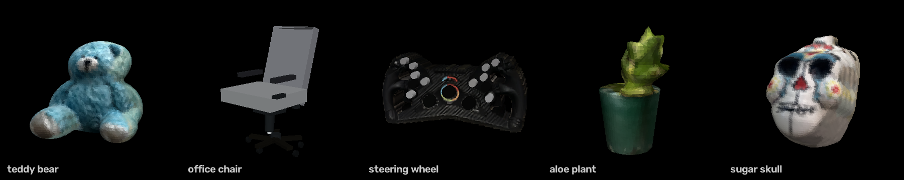
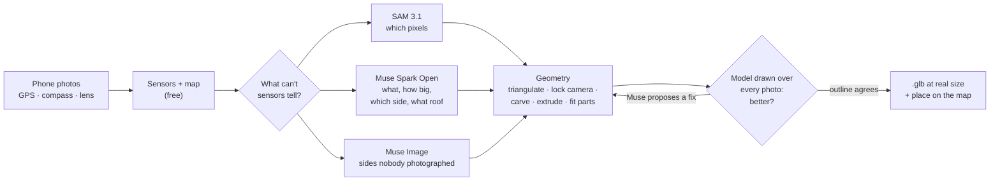

# PlaceLens

[](https://github.com/inlighten420/placelens/actions/workflows/test.yml)

[](LICENSE)

**Take photos of something real (your house, a chair, a teddy bear) and PlaceLens builds it in 3D at its real size.
A building goes on its real spot on the real map, in place of the map's grey box.** The phone's GPS, compass and lens
and the map do the free work; Meta's models answer only what sensors can't: what is it, how big, which floors, what
roof. And every model answer is checked against geometry before it's used.

**▶ [Watch the 3-minute demo](https://youtu.be/FGEI_P3rk2w)**

Built for the Meta Global AI Developer Hackathon (26 Oct – 4 Nov 2026), theme *Build for Your World*. Everything in
this repo was built during the hackathon. The game it plugs into, [Open-Planet](https://github.com/inlighten420/open-planet)
(a driving game of the real world), existed before and is not part of this entry; PlaceLens is an add-on for it,
and its place packs can be read by any engine.


*Made from 3 to 6 phone photos each, with Find its parts. Spin them round yourself: [`examples/`](examples).*

**Technical deep dive: [docs/ARCHITECTURE.md](docs/ARCHITECTURE.md)**, covering every model call, every algorithm and
every trade-off.

## How it works



| Step | How | Meta model |
|---|---|---|
| Read the photo | EXIF: GPS, compass, lens width (HEIC and JPEG) | |
| Which building | Each photo is a line from where you stood; **weighted least squares** finds where the lines meet, and photos whose line misses are dropped with a reason. Footprints from Overture Maps (OpenStreetMap + Google + Microsoft), else OpenStreetMap | **SAM 3.1** (where across the photo), **Muse Spark Open** (how far, asked without the map) |
| Line the photo up with the map | Camera position and heading searched so the footprint's edges land on SAM's outline, held close to what the phone said | **SAM 3.1** |
| Outline it, cut it out | Pixel masks of the building, the object, windows, doors, logos | **SAM 3.1** |
| What is it, how big | One research question, asked 3–5 times in parallel and voted: what it is, how such things are made, real size, floors, roof, colours, brands | **Muse Spark Open** |
| Which side each photo shows | Compass first; Muse checks it, and wins when the compass is clearly off (indoors) or the object was turned in place | **Muse Spark Open** |
| Sides nobody photographed | Drawn from the one photo; each drawing is used only if Muse names the side it shows and SAM finds the object in it | **Muse Image** |
| The shape | Buildings: footprint split into roof blocks, raised to height, real windows and doors cut through the walls. Soft objects: **visual hull** carved from the cut-outs (voxels + marching cubes). Hard, made things (a chair): Muse's parts **fitted into the carving**. Opt-in, **Find its parts**: SAM 3.1 finds each part in every photo; soft things are rebuilt from **smooth parts** (and rigged to move), made things keep Muse's design, fitted to those outlines. Round things: turned on a lathe | |
| Brands | Logos found and painted over before anything goes in a game | **SAM 3.1** |
| The check | The model drawn over every photo from its own camera; Muse proposes fixes, and each is **kept only if the outline overlap improves across the photos** | **Muse Spark Open** |
| The plan | An agent groups a folder of photos and runs the makers through **tool calls** | **Muse Spark Open** |

### Meta models and API calls

All model traffic goes through one module, [`meta.py`](src/placelens/meta.py), with a cost log and a switch that
blocks paid calls. Every question goes through [`muse.py`](src/placelens/muse.py), which caches answers on disk and
votes.

| Model | API | Used for | Why |
|---|---|---|---|
| **SAM 3.1** (`sam-3.1`) | Meta Model API, `responses` (streamed, one-bit masks), decoded with Meta's `meta-sam-parser` | Masks from a noun: building, house, the object; with Find its parts, each of its parts (head, arm; backrest, armrest) and the buttons and knobs on a flat thing; window, door, garage door, logo | Exact outlines: the measurement that every other answer is checked against |
| **Muse Spark Open** (`meta-models/muse-spark-open-1026`) | Baseten, OpenAI-compatible `chat/completions` with `reasoning_effort` and tool calls | All reasoning: research, sizes, distances, sides, roofs, colours, critiques, parts lists, the agent | Open weights, multi-image reasoning, tool calls; cheap enough to ask 3–5 times and take the median |
| **Muse Spark** (`muse-spark-1.3`) | Meta Model API, `responses` | The same questions when there's no Baseten key; a second opinion on an unsure side | One key is enough to run PlaceLens |
| **Muse Image** (`muse-image-1.0`) | Meta Model API, `images/edits` (multipart, reference photos) | The back and sides of an object from one photo | Keeps pose and colours. Its drawings are checked before they're used |

### Engineering highlights

- **The trick: no model ever generates 3D.** The AI only answers small questions about flat photos: a SAM mask (a
  quarter of a cent), or a Muse size or side. Classical geometry on your own computer (projection, visual hull
  carving, marching cubes) turns those answers into 3D, for free and in seconds. That's why an aloe plant takes 49 s
  and costs 1¢. [The maths](docs/ARCHITECTURE.md#the-trick-no-model-ever-generates-3d)
- **Sensors first, models for the gaps.** GPS, compass, field of view and map footprints are free and mostly right;
  models answer only the semantic questions. A make costs 0.25¢–8.5¢ in Meta API calls, plus Muse Spark Open tokens on Baseten. [More](docs/ARCHITECTURE.md#1-the-design-rule-sensors-first-models-for-the-gaps)
- **Models propose, measurements decide.** Muse sees *what's* wrong; SAM's outline measures *how much*. Building
  edits come from a fixed menu and are scored by roofline profile and corner alignment. Object edits are scored by
  mean IoU across every photo at once, so fixing one view can't break another. [More](docs/ARCHITECTURE.md#6-verification-loops-models-propose-measurements-decide)
- **Triangulation over voting.** Choosing the building by per-photo votes picked the neighbour's house 6–1 once the
  map filled in; a weighted least-squares meeting point with outlier rejection got it right. [More](docs/ARCHITECTURE.md#4-buildings)
- **Voted, cached, parallel model calls.** A single answer's numbers wobble (the same house 4 m or 11 m away), so
  answers are asked 3–5 times in parallel and merged by median or majority, with agreement folded into the
  confidence. Every reply is cached by prompt hash, so a remake is nearly free. [More](docs/ARCHITECTURE.md#3-the-meta-model-layer)
- **A real agent with real guardrails.** The survey agent's tools are PlaceLens's own CLI commands run as
  subprocesses with `--json`. It has budgets for heavy calls, truncated tool results and a full transcript, and it
  asks the person only when it's unsure. [More](docs/ARCHITECTURE.md#7-the-survey-agent)
- **Each thing built the way it's made** (Find its parts). SAM 3.1 finds each part in every photo, and each piece
  becomes the clean shape the photos earn (rounded, a cylinder, a taper, a box) or stays carved; a made thing keeps
  Muse's design, fitted to the parts; a flat thing is built from its exact outline. Kept only where a photo **left out
  of the whole make** is predicted at least as well as by the carving. [More](docs/ARCHITECTURE.md#5-objects)
- **Built, not pasted.** Buildings are built clean in the colours Muse reads, with real openings (reveals, frames,
  glazing bars, sills), not a photo stretched over a box with trees and cars on it. Objects are geometry painted from
  the photos; a photo goes on as a picture only when there are just one or two of them, and the make says so.
- **Standard outputs.** glTF binary written directly (no Blender), plus a place-pack manifest any engine can read,
  plus a Godot adapter that replaces the map's grey box. [More](docs/ARCHITECTURE.md#8-outputs-gltf-place-packs-the-godot-adapter)
- **174 offline tests**, no keys needed, run in CI with lint on every push.

## Try it

**The easy way:** download the repo (green **Code** button → **Download ZIP**), unzip it, and double-click
**`Start PlaceLens.bat`** (on macOS or Linux: `sh start.sh`). The first time, it sets itself up (a few minutes; it
needs [Python 3.10+](https://www.python.org/downloads/)). Then PlaceLens Studio opens in your browser: paste your Meta
API key once, drop in photos, press **Make it 3D**, and drag the model round to see every side. Everything runs on
your own computer; the key is saved in `.env` in that folder.

**See results before you make anything:** [`examples/`](examples) holds five things PlaceLens made with Find its
parts: a teddy bear (smooth parts), an office chair (Muse's design, fitted), a sim-racing steering wheel (built from
its outline), an aloe plant (a clean pot, carved leaves) and a sugar skull (carved). Each one has its model
(`prop.glb`) and a `view.html` you can double-click to spin it round in a browser, no key or install needed; the teddy
and the aloe also have `prop_moving.glb`, the same parts on joints. The studio shows them the first time
it opens, so you can turn them round and send them to the game straight away. Only the finished models are
included: the photos they were made from stay private.

**The developer way:**

```sh
git clone https://github.com/inlighten420/placelens && cd placelens
python -m venv .venv
.venv/Scripts/pip install -e ".[dev]"        # .venv/bin/pip on macOS/Linux
.venv/Scripts/python -m pytest -q            # 174 tests, offline, no keys needed
.venv/Scripts/activate                       # source .venv/bin/activate on macOS/Linux: puts `placelens` on the path
```

### API keys

PlaceLens talks to two services. Both are OpenAI-compatible APIs.

| Key | Service | What runs there | Where to get it | Needed? |
|---|---|---|---|---|
| `MODEL_API_KEY` | **Meta Model API** (`api.meta.ai/v1`) | SAM 3.1 (cut-outs), Muse Image (drawn sides), and Muse Spark when there's no Baseten key | [dev.meta.ai](https://dev.meta.ai/docs/quickstart) | Yes |
| `BASETEN_API_KEY` | **[Baseten](https://www.baseten.co/)** (`inference.baseten.co/v1`), a model-hosting platform | **Muse Spark Open**, Meta's open-weights Muse: all the reasoning, the checks and the survey agent | Your Baseten account: Settings → API keys | Recommended |

**Without a Baseten key**, every Muse question goes to Muse Spark on the Meta API instead, on your Meta key (a few
cents more per make), and PlaceLens says so once. The survey agent needs Spark Open's tool calls, so without a
Baseten key you tell it what the photos show (`--kind object` or `--kind building`; in the game, *What is it?*) and it
skips the planning.

Put the keys in any one of these places:
- paste them into the studio the first time it opens (it saves them for you);
- or put them in a `.env` file in the repo folder (gitignored, never committed);
- or set them as environment variables (`setx MODEL_API_KEY ...` on Windows, `export MODEL_API_KEY=...` elsewhere).

```sh
# .env
MODEL_API_KEY=...       # Meta Model API
BASETEN_API_KEY=...     # Baseten: Muse Spark Open
```

Then make something. The easiest way is the studio, a page in your browser on your own computer:

```sh
placelens studio      # drop photos, press Make, then drag the 3D model round to see every side
```

In the studio:
- **The circle** places your photos round the object by each photo's compass; drag one if it's wrong.
- **How it was made** shows every step, which Meta model did it, and how long it took.
- **Remake** makes a thing again from the same photos; saved answers make it quick and nearly free.
- **Self-checks** sets how many times Muse looks at what it built and corrects it.
- **Find its parts** has SAM 3.1 find each part in every photo, and fits the model to them: a soft thing (a teddy)
  becomes smooth rounded parts instead of the flat cuts carving leaves where no photo looked, with a version that
  moves; a plant's pot becomes a clean tapered cylinder while its leaves stay carved; a made thing (a chair) keeps
  Muse's design, fitted to your photos; a flat thing (a steering wheel) is built from its exact outline, painted from
  the photo, with its buttons and knobs raised in 3D. About a US cent a photo in SAM calls.
- **How it was made** also shows what the models saw: SAM's outline, the parts it found, and the model over each photo.
- **Send to game** puts it in Open-Planet in a few seconds.
- **Download** gives you the `.glb` for any engine.

Or from the command line:

```sh
placelens object chair_front.jpg chair_side.jpg chair_back.jpg   # an object: walk round it, or one good photo
placelens build house_*.jpg                                      # a building, from photos taken round it
placelens survey my_photos/                                      # an agent sorts the photos and makes it all
placelens info photo.jpg                                         # what the photo knows: GPS, compass, lens
placelens find photo.jpg                                         # which mapped buildings are in view
placelens pick photo.jpg                                         # which one it is (geometry and Muse must agree)
placelens pack home out/build/IMG_0001 out/objects/IMG_0101        # gather builds into a place pack
```

Each make writes a `.glb` model, a `view.html` to look at it in a browser, and says what it cost.

**Photos that work best:** a phone's own camera app with location on (iPhone HEIC or JPEG). For an object, **4 photos:
front, both sides and back**, the whole thing in each, phone at about its middle height (a 5th from above helps);
or one straight-on photo from the front. 3 photos leave its corners cut flat; 4 round them out. For a building, take
the street side from a few spots and the corners. Photos without GPS or compass still work for objects (Muse works
out which side each photo shows); a building needs at least one photo with GPS and compass.

## Results and cost

**Why it's cheap:** the sensors and the map are free and mostly right, so the models only fill the gaps, and no
model ever generates 3D (see [the trick](docs/ARCHITECTURE.md#the-trick-no-model-ever-generates-3d)). A make has two
bills: paid Meta API calls (SAM 3.1, Muse Image), priced from Meta's published rates, and Muse Spark Open tokens on
Baseten. Real makes in the studio, as each make recorded them:

| Thing | Photos | Time | Meta API | Muse Spark Open on Baseten |
|---|---|---|---|---|
| Sugar skull | 3 | 31 s | 0.25¢ (1 call) | 2 calls, 13k tokens |
| Aloe plant | 4 | 49 s | 1¢ (4 calls) | 6 calls, 34k tokens |
| Teddy bear | 9 (6 used) | 1 min 27 s | 1.5¢ (6 calls) | 8 calls, 49k tokens |
| Steering wheel | 4 | 2 min 38 s | 4.5¢ (18 calls) | 7 calls, 35k tokens |
| A house | 10 | 11 min 41 s | 8.5¢ (34 calls) | 127 calls, 904k tokens |

**Objects are light on both bills.** One research question and a few side checks come to 2–8 Spark Open calls.
**Buildings are heavy on Baseten.** Muse is asked about every photo several times (5–7 votes, side checks at high
reasoning effort), because a single answer's distances and sides wobble. That's the reliability-for-tokens trade,
and it's what makes the first build of a house slow. Every answer is saved, so making the same thing again costs
almost nothing on either bill. This build was recorded before the roof questions ran in parallel.

**Find its parts adds SAM 3.1 calls**, a quarter of a US cent each, and one more Spark Open question:

| Thing | What it asks SAM 3.1 for | Extra SAM calls | Extra Meta API |
|---|---|---|---|
| Teddy bear | head, arm, leg, ear in 6 photos | 24 | 6¢ |
| Office chair | its 6 biggest kinds of part in 4 photos | 24 | 6¢ |
| Steering wheel | buttons and knobs, front and back | 4 | 1¢ |
| Aloe plant | leaf in 4 photos | 4 | 1¢ |

The fitting itself is NumPy on your computer: 10 seconds to 2 minutes.

Baseten bills Spark Open by token. This project ran on the hackathon's Baseten credits, so check the Baseten
dashboard (Usage) for the current price. Every call is logged locally: `out/meta_usage.jsonl` has each paid Meta
call with its price, `out/open_usage.jsonl` has each Spark Open call with its tokens and seconds, and
`python scripts/open_usage.py` adds them up. `PLACELENS_META_OFF=1` replays a make from saved answers with paid calls
blocked.

## In the game

`python adapters/godot/install.py <Open-Planet Godot folder> --photos <your photo folder>` adds PlaceLens to
Open-Planet (Godot 4.7; `--uninstall` takes it out). In the game, **F7** opens PlaceLens: choose photos, say what it
is, Make. **I** opens your things: put what you made anywhere, or use a steering wheel as your car's. Buildings
replace the map's box where they really stand. PlaceLens's windows wear its own blue, so it's clear what's the add-on.
Things made in the studio go in with **Send to game**: the installer tells the studio where the game's packs are, and
the game picks new ones up while it runs.

## For agents

Every command takes `--json`. When a photo is missing something, the exit code is `2` and the error says how to fix
it (`--lat`/`--lon` for no GPS, `--heading` for no compass); `3` means it isn't sure which building it is.
`survey --progress FILE` writes each step as a JSON line while it works (the game and the studio read it).

## Repository layout

```
src/placelens/        the package (one module per job; see the module map in docs/ARCHITECTURE.md)
  meta.py, muse.py      Meta model client, cost log; cached, voted, parallel questions
  photo.py, footprints.py, osm.py, view.py          inputs: EXIF, map footprints, view cone
  pick.py, buildings.py, sides.py, front.py, roof.py, critique.py, look.py, build.py   buildings
  objects.py, carve.py, soft.py, align.py, flat.py, seen.py, imagine.py, parts.py, fit.py,
  sight.py, prop.py                                                                   objects
  judge.py, dress.py, solve.py   first-generation object experiments, kept for comparison
  survey.py             the tool-calling agent
  studio.py, studio.html  the local web app
  pack.py, viewer.py, render.py   place packs, view.html, map pictures
  progress.py           step-by-step progress for the game and the studio
  cli.py                every command
adapters/godot/       the Open-Planet add-on (installer + 4 GDScript files)
tests/                174 offline tests (pytest), one file per module
scripts/              probes and evaluations used while building (see scripts/README.md)
docs/                 ARCHITECTURE.md, the day-one plan for comparison, and the examples picture
examples/             five finished models (prop.glb + view.html), shown in the studio on first start
```

## Honest limits

- Without Find its parts, thin parts (chair legs, armrests) are hard to carve; a chair comes out blocky. With it,
  the chair keeps Muse's design, but its parts are simple boxes and cylinders.
- One or two photos: the photo goes on as a picture (a cut-out, or wrapped on a lathe). Three photos leave flat sides
  (the sugar skull): walk round with four or more.
- Find its parts finds only what SAM 3.1 knows by name, in photos where the thing is big enough: the steering wheel's
  back photo, taken low and far off, gave it no buttons to raise.
- Find its parts' rules (how solid a piece must be for a clean shape, how close a flat face must come to win) were set
  on a handful of objects; each falls back to carving when unsure, and each threshold is written down with the
  numbers that set it.
- A one-photo object looked down on from above can come out squat (the drawings are level).
- Buildings follow the map's footprint; a wrong footprint gives a wrong shape. Tested mostly on one house.
- Phone compasses are poor indoors and in narrow passages; Muse corrects objects (or drag them on the circle),
  buildings need open air.
- A building is slow the first time (5 to 15 minutes: Muse checks every photo several times).
- The first start installs everything, which can take up to 10 minutes; after that it starts in seconds.
- `cli.py` holds the building pipeline as well as the commands, and is the biggest file; splitting it out is next.

## Privacy

Your own photos go in `private/`, which is never committed. Everything made goes to `out/`, also gitignored. Keys
stay in a local `.env`. The studio only listens on your own computer. Brand logos are painted out of objects.

## Credits

- Building footprints: [Overture Maps](https://overturemaps.org/) and © [OpenStreetMap](https://www.openstreetmap.org/copyright) contributors, ODbL.
- SAM masks decoded with Meta's [`meta-sam-parser`](https://github.com/meta-models/meta-sam) (SAM License).
- Test fixture `tests/data/sam_city_hall.txt` is SAM 3.1's output on
  [Cape Town City Hall (6186284748).jpg](https://commons.wikimedia.org/wiki/File:Cape_Town_City_Hall_(6186284748).jpg),
  Wikimedia Commons, CC BY 2.0.

MIT licence: see [LICENSE](LICENSE).
