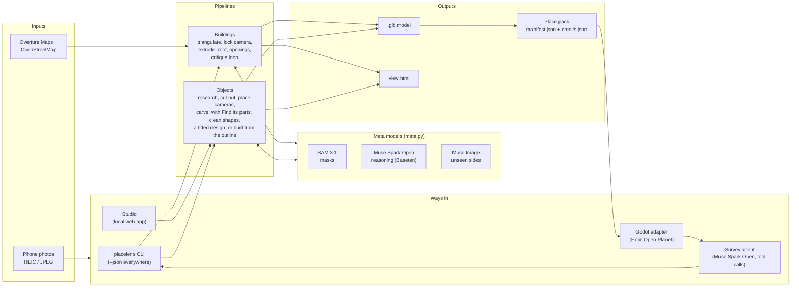
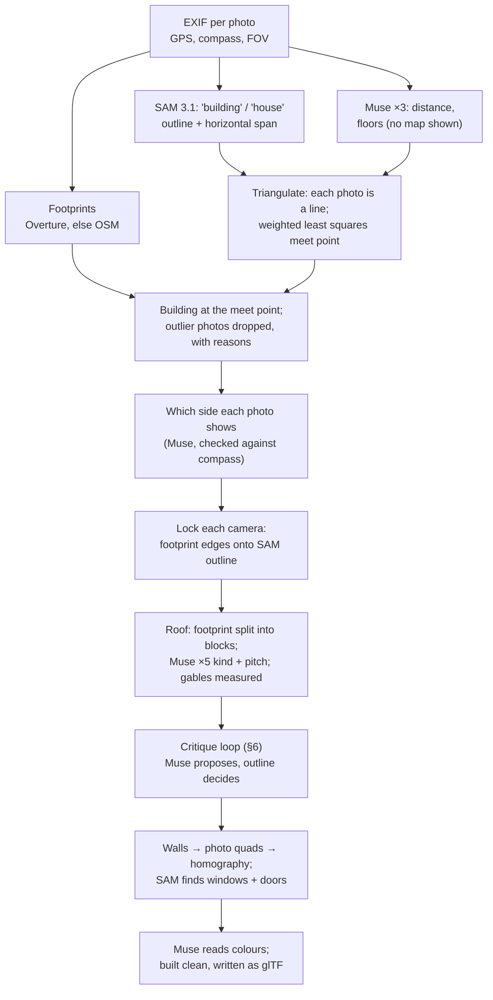
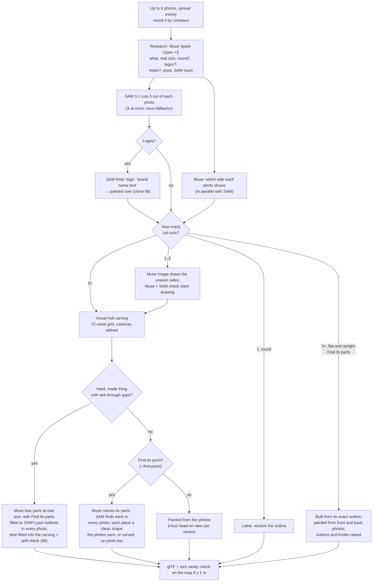

# PlaceLens architecture

How PlaceLens turns phone photos into 3D models at real size on the real map: every Meta model call, what it's for,
and the geometry around it. The [README](../README.md) is the short version; this is the long one.

- [1. The design rule: sensors first, models for the gaps](#1-the-design-rule-sensors-first-models-for-the-gaps)
- [2. System overview](#2-system-overview)
- [3. The Meta model layer](#3-the-meta-model-layer)
- [4. Buildings](#4-buildings)
- [5. Objects](#5-objects)
- [6. Verification loops: models propose, measurements decide](#6-verification-loops-models-propose-measurements-decide)
- [7. The survey agent](#7-the-survey-agent)
- [8. Outputs: glTF, place packs, the Godot adapter](#8-outputs-gltf-place-packs-the-godot-adapter)
- [9. PlaceLens Studio](#9-placelens-studio)
- [10. Cost, speed and reliability](#10-cost-speed-and-reliability)
- [11. Testing](#11-testing)
- [12. What we tried and dropped](#12-what-we-tried-and-dropped)
- [13. Module map](#13-module-map)

---

## 1. The design rule: sensors first, models for the gaps

A phone photo already holds most of what's needed to place a thing on a map:

| Fact | Free source | Typical error |
|---|---|---|
| Where you stood | EXIF GPS | 5–15 m |
| Which way you faced | EXIF `GPSImgDirection` (compass) | 10–20° (much worse indoors) |
| How wide the lens saw | EXIF 35 mm-equivalent focal length → horizontal field of view | small |
| The building's shape and position | Overture Maps / OpenStreetMap footprint | depends on the mapper |

What sensors *can't* tell is semantic: what the thing is, which pixels belong to it, how tall it is, how many floors,
what kind of roof, which side a photo shows when the compass is unreliable. **Those, and only those, go to Meta's
models.** Every model answer is then checked against geometry before it's used (§6). That rule is why a make costs
cents rather than dollars, and why one bad answer can't wreck a result.

### The trick: no model ever generates 3D

The usual way to get 3D from photos is a large image-to-3D model that guesses the whole shape. PlaceLens doesn't use
one. Every model call is a **small question about a flat photo**: a SAM 3.1 mask (a quarter of a US cent) or a short
Muse answer (a size, a side, a roof type). The 3D is made by **classical geometry on the user's own CPU**: carving a
visual hull, extruding a footprint, fitting a few parts. That geometry costs nothing and takes seconds.

| | Image-to-3D model | PlaceLens |
|---|---|---|
| What the AI does | Invents the whole 3D shape | Answers 2D questions: which pixels, what is it, how big |
| What makes the 3D | The model | NumPy on your computer: projection, carving, marching cubes |
| Real size and position | Unknown | From EXIF, the map and Muse's size, then checked |
| Checked against the photos | Not by design | Every result is projected back onto the photos and scored (§6) |

A make costs 0.25¢–8.5¢ in Meta API calls (an aloe plant: 4 photos, 49 s, 1¢), plus Muse Spark Open tokens on Baseten.

The trade-off is honest: carving can only remove what some photo sees as background, so a hollow no photo looks into
stays filled, and thin parts are hard. For game props that sit in a stylised world, that's a good trade: real size,
real colours, the right silhouette from every side, in under a minute, for about a cent.

## 2. System overview



Everything ends up in one of two pipelines (`build` for buildings, `object` for objects), reached four ways. The
studio and the agent run them as **subprocesses with `--json`**, the same commands a person would type. That keeps
one code path, makes every step reproducible from the shell, and means a crash in one make can't take down the
caller.

## 3. The Meta model layer

All model traffic goes through [`meta.py`](../src/placelens/meta.py) (one client, one cost tally) and
[`muse.py`](../src/placelens/muse.py) (caching and voting). No other module talks to an API directly, which is what
lets the tests run with no key and no network.

### Models, endpoints and why each one

| Model | Model id | Endpoint | What PlaceLens asks it | Why this model |
|---|---|---|---|---|
| **SAM 3.1** | `sam-3.1` | Meta Model API `POST /v1/responses` (streamed), `metadata.mask_encoding: "one_bit"` | Pixel masks for a short noun phrase: `building`, `house`, `teddy bear`, `window`, `garage door`, `logo`, `brand name text` | Text-prompted segmentation at full resolution. The masks are the ground truth that every other answer is checked against |
| **Muse Spark Open** | `meta-models/muse-spark-open-1026` | Baseten `POST /v1/chat/completions` (OpenAI-compatible, `reasoning_effort`, tool calls) | All the reasoning: what it is, real size, floors, distance, roof type and pitch, which side a photo shows, materials, critiques of the model drawn over the photos, parts lists, the survey agent's planning | Open weights; strong multi-image reasoning; supports tool calls and a thinking budget. Running on hackathon credits, it's cheap enough to **ask 3–5 times and vote** |
| **Muse Spark** | `muse-spark-1.3` | Meta Model API `POST /v1/responses` | The same questions, when no Baseten key is set; a second opinion on a side that Spark Open was unsure of (`--second-opinion`) | Same family on the main API, so PlaceLens works with just one key |
| **Muse Image** | `muse-image-1.0` | Meta Model API `POST /v1/images/edits` (multipart, up to 10 reference images) | Draw the back, left and right of an object from a single photo | It keeps pose and colours when drawing standard views. Each drawing is then checked by Muse and SAM before it's used (§5) |

SAM's masks come back in Meta's compact run-length format and are decoded with Meta's own
[`meta-sam-parser`](https://github.com/meta-models/meta-sam) (`image_segmentation_format().create_parser()`,
`decode_mask_to_raster`), not by hand. Big masks come back scaled down and are resized to their bounding box. Decoding
is slow in pure Python (2 of a cached house's 2.5 minutes, 1 Nov), so decoded masks are cached beside the raw reply as
`.masks.npz`.

### Every question goes through `muse.ask`

```python
answers = ask(meta, prompt, photos, reply=Path(".../roof_ab12cd34.txt"), model=OPEN, votes=5, effort="high")
```

- **Cached on disk.** Each vote's reply is saved to a file named from the prompt's hash. Asking again is free, so
  **Remake** in the studio and re-running a command cost nothing unless the question changed. Adding the user's
  notes changes the prompt, and so the cache key, so only what the notes affect is asked again.
- **Voted.** One answer's numbers wobble: Spark Open put the same house 4 m and 11 m away. So numeric questions are
  asked 3–5 times **in parallel** (8 threads; Baseten answered 8 at once in 17 s against 13 s for one) and merged:
  the median for numbers, the majority for choices, with the share that agreed folded into the confidence
  (`merge_props`, `merge_sides`, `merge_verdicts`, `merge_looks`).
- **Failure-tolerant.** A vote that times out or comes back empty (cut off while still reasoning) is left out, not
  saved, and asked again next time. The question fails only if *no* vote came back.
- **Reasoning budget.** Spark Open gets `max_tokens` 6,000, or 16,000 at `effort="high"`. High effort is used only
  where it pays: building critiques and parts lists. The agent's planning runs at `low` (one planning call once
  thought for 116 s).
- **Timeouts.** 90 s and 2 retries on Baseten. The client's default of 600 s once hid a 257 s stall.

### Cost control built into the client

- Every paid call is priced from Meta's published rates (SAM $2.50 per 1,000 images; Muse Spark $1.25 / $4.25 per 1M
  input / output tokens; Muse Image $0.01 a picture) and appended to `out/meta_usage.jsonl`. Every Spark Open call
  logs its tokens and seconds to `out/open_usage.jsonl`. `usage_since(t)` adds both logs up, so a make run as a
  subprocess still reports its own cost to the studio or the agent.
- `PLACELENS_META_OFF=1` turns any paid Meta call into a `PaidCallBlocked` exception, so a whole run can be replayed
  from saved replies with a guarantee of spending nothing. The game's panel exposes the same switch.

## 4. Buildings

`placelens build house_*.jpg` → `building.glb`, `place.geojson`, `view.html`.



**Footprints** ([`footprints.py`](../src/placelens/footprints.py), [`osm.py`](../src/placelens/osm.py)). Overture
Maps first, read straight from its public GeoParquet files with the `overturemaps` package. Overture merges
OpenStreetMap with buildings traced by Google and Microsoft: on one test street it found 157 from OSM plus 102 more
that nobody had mapped. If Overture can't be reached, it falls back to OSM's Overpass API, with retries and a disk
cache. A building that came from OSM keeps its `way/<id>`, so a game can replace its own box with the model.

**Which building: triangulation** ([`buildings.py`](../src/placelens/buildings.py)). Each photo becomes a line on the
map: from its GPS, along its compass corrected by where SAM's outline sits across the frame, out to the distance Muse
estimates. Muse is asked **without the map**, so its answer can't be anchored by the candidates. The lines are solved
together by **weighted least squares**: across each line, its error is the compass error at that distance (12°);
along it, Muse's distance error (35%). Before the fit, a median start point catches outliers so they can't bend it.
After it, the worst photo whose line misses by more than 3× its own error is dropped and the fit is re-run (up to 3
times). The building whose footprint contains the meeting point is chosen. If its support is under 1.5× the
runner-up's, it's a close call and the person is asked. Every dropped photo gets a reason in plain words ("its
compass or GPS is off: its line misses where the others meet by 23 m").

This replaced per-photo voting. Voting worked while the test house stood nearly alone on the map, but once Overture
filled in the neighbours, 6 of 7 photos voted for the house next door. Triangulation got it right with the same
photos.

**One photo: two independent checks must agree** ([`pick.py`](../src/placelens/pick.py),
[`view.py`](../src/placelens/view.py)). Rays are cast across the lens's field of view, plus a margin for compass
error. Each ray stops at the first wall it hits, so hidden buildings drop out. *Geometry:* SAM's outline gives the
building's left and right bearings, which are slid a few degrees against each candidate's footprint span to find
the best overlap (this also measures the compass error). *Muse:* sees the photo and the candidates' map facts and
names one, with a confidence. **Picked only if both agree, Muse is at least 70% sure, and the geometry fits at least
50% and leads the runner-up 3×.** Anything else exits with code `3` and a map of the candidates, so the person can
choose.

**Locking the camera** ([`front.py`](../src/placelens/front.py)). The phone's GPS and compass are too rough to
texture a wall. So PlaceLens searches positions within 15 m of the GPS (0.5 m steps). For each spot, the turn that
puts the footprint's projected left and right edges onto SAM's outline has a **closed form**, regularised towards
the compass and capped at 15°. Moving and turning further from what the phone said costs more. Once Muse has said
which side a photo shows, only the walls on that side are matched. That camera is what everything after it projects
through.

**Roof** ([`roof.py`](../src/placelens/roof.py)). The footprint is split at its reflex (inward) corners into
rectangular blocks, so an L-shaped house becomes two gabled blocks, as most are built. Muse reads the roof kind
(gable / hip / flat), ridge direction and pitch from the photos (5 votes, combined by confidence). Where a gable end
is visible, its pitch is **measured** from SAM's outline near the predicted peak, and that wins over Muse's guess.

**Walls, windows and doors** ([`front.py`](../src/placelens/front.py), [`build.py`](../src/placelens/build.py)).
Every wall facing a locked camera has its four corners projected into the photo. A **homography** (8-parameter
DLT) warps that quad into an upright wall image at metric scale. SAM 3.1 is asked for `garage door`, `door` and
`window` in each straightened wall, and those become real geometry: holes cut through the wall mesh with reveals,
glass set back in them, frames, glazing bars about every 0.9 m, sills that stand out, door handles, and ribbed
garage-door panels. When several photos see one wall, the view that faces it most squarely wins. Walls nobody
photographed can mirror the opposite wall of the same length (`--symmetric`).

**Built, not pasted** ([`look.py`](../src/placelens/look.py)). The walls aren't painted with the photo (that carries
trees, cars and the neighbour's fence onto them). Muse reads the colours of the walls, roof, window frames and doors,
and the model is built clean in those colours, in linear-space PBR materials.

## 5. Objects

`placelens object front.jpg left.jpg back.jpg right.jpg` → `prop.glb`, `object.json`, `view.html`.



**Research first, one question** ([`objects.py`](../src/placelens/objects.py)). Before anything is built, Muse Spark
Open looks at the front photo and answers one structured question, 3 times: what the thing is, how such things are
made, real width / depth / height, whether it's round, whether it shows a brand, whether it has see-through gaps,
how it's posed, and the best short noun for SAM. One research question replaces a scatter of small ones, and it
grounds the size in what Muse knows about the category, not just what the pixels suggest.

**Finding it with SAM.** SAM recognises things by some names and not others: it found a racing wheel as `game
controller`, not `steering wheel`. So the first photo tries Muse's candidate nouns in turn (at most 5, a quarter of
a cent each), and the rest of the photos start from the noun that worked. Seen from behind, an object may not look
like its name at all (a skull candle holder from the back looks like a vase). Then Muse is asked what *this* photo
shows, and SAM tries that.

**Where each photo was taken from.** The compass gives the angle round the object. Muse, shown the front photo next
to each other photo, names the side (front, front-left, … back, or above), and this question runs **while SAM is
still cutting out**, so it adds no wall-clock time. Muse wins where the compass is clearly unreliable (indoors) or
the object was turned in place instead of walked round. In the studio, the person can drag photos round a compass
circle to override both.

**Visual hull carving** ([`carve.py`](../src/placelens/carve.py)). Each cut-out is the object's silhouette from one
direction. A 72-voxel grid (sized 1.3× Muse's size estimate) is projected into every photo, and any voxel outside a
silhouette is carved away. A few details make this work on real phone photos:

- *Forgiveness near edges, none far away.* A voxel may fall outside one side view's silhouette and survive (the
  compass is a few degrees off), unless it's clearly outside (more than 2% of the photo height). An overhead photo
  can never be outvoted, as it's the only one that sees into hollows.
- *Frame-aware.* Beyond a photo's edge, a voxel only counts as outside if the object doesn't itself run off that
  edge.
- *Camera refinement* (`fit_cameras`). Compass angles, camera height and distance are each nudged in turn, keeping a
  step only if the strict carving then matches *all* the cut-outs better. The front photo's angle is held fixed to
  remove the gauge freedom.
- The kept grid is blurred by one voxel and meshed with **marching cubes** (scikit-image). Each vertex is painted
  from the photo that faces it most squarely.

**The maths of carving.** Each photo $i$ is a pinhole camera on a sphere round the object: angle round $a_i$ from
the compass (checked by Muse), angle down $e_i$, and distance $d_i$ from similar triangles, using Muse's real height
$H$ and the cut-out's height in pixels $h_i$ (focal length $f$ in pixels, from EXIF):

```math
d_i = f\,\frac{H}{h_i}, \qquad
\mathbf{c}_i = d_i\,(\cos e_i \sin a_i,\ \sin e_i,\ \cos e_i \cos a_i) + (0,\ y_{\text{mid}},\ 0)
```

Every voxel centre $\mathbf{p}$ is projected into every photo with the camera's right, up and forward unit vectors
$\mathbf{r}_i, \mathbf{u}_i, \mathbf{w}_i$ and the pixel where the object's middle shows, $(c_x, c_y)$:

```math
z = (\mathbf{p}-\mathbf{c}_i)\cdot\mathbf{w}_i, \qquad
\text{col} = c_x + f\,\frac{(\mathbf{p}-\mathbf{c}_i)\cdot\mathbf{r}_i}{z}, \qquad
\text{row} = c_y - f\,\frac{(\mathbf{p}-\mathbf{c}_i)\cdot\mathbf{u}_i}{z}
```

A voxel is kept if it lands inside the cut-out $M_i$ in all side photos but at most `misses`, inside every overhead
photo, and not clearly outside any (more than 2% of the photo's height from the outline, by a distance transform):

```math
\text{keep}(\mathbf{p}) \iff \sum_{i \in \text{side}} M_i(\pi_i(\mathbf{p})) \ \ge\ n_{\text{side}} - \text{misses}
\ \wedge\ \bigwedge_{j \in \text{overhead}} M_j(\pi_j(\mathbf{p}))
\ \wedge\ \neg\,\text{clearly\_outside}(\mathbf{p})
```

Then only the largest connected piece is kept. The whole grid (up to 72³ ≈ 370,000 voxels) is projected as one NumPy
array per photo, which is why carving takes seconds. Camera refinement (`fit_cameras`) re-runs this carving hundreds
of times while nudging each camera, so each photo's distance-to-outline map is computed once and cached.

**The score every check uses** is intersection over union between the model's silhouette $S$ and SAM's cut-out
$M$, averaged over the photos:

```math
\text{IoU}(S, M) = \frac{|S \cap M|}{|S \cup M|}, \qquad
\text{score} = \frac{1}{n}\sum_{i=1}^{n} \text{IoU}(S_i, M_i)
```

**One or two photos.** These are the only makes where a photo goes on as a picture (a cut-out, or wrapped on a
lathe): building needs a walk round. The make says so in its warnings, and tells you to take 3 or more.
Two silhouettes crossed carve a block, so instead **Muse Image draws the missing standard sides** (back, left, right). It doesn't always draw what was asked, so **Muse Spark looks at each drawing next to
the photo and names the side it shows**, and **SAM must find the object in it** (a drawing of the wrong side, or
one SAM can't find, is dropped). The drawings that pass carve gently: their outlines are widened by 3% and they only
paint what no real photo sees. A round thing (a pot, a tank) skips this and is **turned on a lathe** from its one
outline ([`prop.py`](../src/placelens/prop.py)).

**Made things, with Find its parts** ([`align.py`](../src/placelens/align.py), the same opt-in). Muse Spark
Open describes a made thing well as shapes: the office chair as a backrest, a seat, armrests on struts, a gas lift and
a five-star base on casters. Fitting that design into the carving (below) wrecked it, because a chair's carving is a
blob: thin legs and gaps can't be carved, so the legs were thrown out and the rest squashed. SAM 3.1's outline of the
chair, though, is exact, casters included. So with Find its parts the design is fitted to the photos instead:

1. Muse names each shape with the everyday word for it ("backrest", "armrest", "leg", "handle"), so SAM 3.1 can
   find it. SAM is asked for the six biggest kinds in every photo. Whatever is inside the outline but none of those
   is the rest (a chair's gas lift and struts), and the parts SAM couldn't find are fitted to it, the way a teddy's
   body is what's left of its cut-out.
2. The whole design moves, turns and scales to match every photo's outline, and each found kind its own masks.
3. Then each assembly moves on its own. An assembly is a found kind with the parts SAM can't see riding along (struts
   with their armrest), and what stands on the floor forms one more group that slides and spins on the floor.
   Something standing up (a backrest) may lean; something flat (a seat) stays level.
4. The cameras are fitted again to the model, then the model to the cameras, twice. The office chair's photo from
   above, whose turn the carving had put 45° out, gets a full turn round first.

Each kind SAM found takes the photos' median colour inside its masks. On the office chair (3 Nov), the outline matched
the photos 67% against 52% as Muse designed it, with the star base, casters and armrests where they are; the design
fitted to the carving had lost them. If SAM finds none of the kinds in two photos, nothing pins the design, and it's
fitted the old way: the standing steering wheel's faceplate and grips weren't found, so it was.

**Flat things, with Find its parts** ([`flat.py`](../src/placelens/flat.py)). When the research says a thing is
flat and standing up (a steering wheel, a sign, a shield), it isn't carved or designed from boxes. Walked round edge
on, a flat thing carves to a slab, and boxes miss its outline; SAM 3.1's outline in the photo that faces it most
squarely (the widest outline for its height) is exact, holes and all. So it's built from that outline, as geometry:
the face on a grid of cells about 2.5 mm across, each a solid column Muse's depth deep, with walls round every edge,
the hand holes' too. Each cell is painted from the photo, as a carving is: colour on the 3D surface, not a picture
laid over it. Its back is painted the same way from the photo taken from behind, mirrored (from behind, left and
right swap) and lined up with the same outline. SAM 3.1 then finds its buttons and knobs on that face, and each becomes its own raised cylinder at its
place and size, in its own colour. The standing steering wheel was a black slab from both carving and boxes (3 Nov);
built this way it has its wings, grips, hand holes, coloured ring and 15 raised buttons and knobs, for two SAM calls.
(It was first given its photo as a picture on a slab, which looked right and was the wrong idea: built, not pasted.)

**What the models saw** ([`seen.py`](../src/placelens/seen.py)). Every make keeps small pictures in its `seen/`
folder: SAM 3.1's outline in each photo (yellow), and with Find its parts, the parts it found in colour and the
finished model over the photo (purple where they agree, red where the model is and the photo isn't, blue the other
way round). The studio shows them under **How it was made**.

**Parts for hard, made things** ([`parts.py`](../src/placelens/parts.py), [`fit.py`](../src/placelens/fit.py)).
Carving can't make a flat seat or open a gap that no outline shows: an office chair came out lumpy. For things
the research flags as hard and see-through, Muse Spark Open (high effort) lists the object as simple shapes at real
size: boxes, cylinders and spheres with position, size, rotation, colour and finish, in Open-Planet's own prop
format. Then [`fit.py`](../src/placelens/fit.py) slides, scales and rotates the set as a whole until the parts sit
inside the carving and fill it, scored on how much of each part is inside the carving and how much of the carving
they fill. Twin parts (left/right armrests) and sets (five chair legs) are kept consistent. Each part takes the
photos' colour where it sits. Then the self-check loop corrects it (§6).

**Smooth parts for soft things** ([`soft.py`](../src/placelens/soft.py), opt-in: `--find-parts`, or **Find its
parts** in the studio). Carving keeps everything inside every photo's outline, so where no photo looked it leaves flat slabs and
wedges: a teddy seen from between two of its photos is all facets. But soft things are made of stuffed, rounded
parts, and that is the knowledge that fills the gaps:

1. Muse Spark Open names the parts that stick out from the main body (3 votes; a name is used if most give it): for
   the teddy, `head`, `arm`, `leg`, `ear`.
2. SAM 3.1 finds every match for each name in every photo. Each photo becomes a label map: body (what's left of the
   cut-out) and each part, the smaller mask winning where two overlap.
3. The photos vote on each surface voxel of the carving: a point z-buffer finds which voxels each photo actually
   sees, and they vote with the label at their pixel. "Body" counts half, because it's what SAM didn't name, so a
   leg SAM missed in two photos stays a leg. The inside takes the nearest surface's label, then a 3×3×3 majority
   smooths it. Connected pieces are split out (two arms), and a piece much smaller than the biggest of its kind
   joins what it touches (a sliver of shoulder a side photo saw over the arm).
4. Each piece becomes an ellipsoid with the same middle and spread as its voxels. All of them are then fitted
   together: each part's centre, radii and turn are stepped in turn, with steps halving each pass, keeping a step only
   if the score rises. The score is the whole model's outline against every photo's cut-out, plus 0.3 × each part's
   outline against SAM's mask for that part.
5. The parts are blended with a smooth union and meshed from the continuous field, so there are no voxel steps. Then
   it's painted from the photos as before.

Each ellipsoid's distance is Quilez's estimate (exact on the surface, smooth everywhere), and the blend is a
log-sum-exp smooth minimum over a width $k$ of 1.5 voxels:

```math
d_i(\mathbf{p}) = \frac{k_0 (k_0 - 1)}{k_1},\quad
k_0 = \left\lVert \frac{R_i^\top(\mathbf{p}-\mathbf{c}_i)}{\mathbf{r}_i} \right\rVert,\quad
k_1 = \left\lVert \frac{R_i^\top(\mathbf{p}-\mathbf{c}_i)}{\mathbf{r}_i^2} \right\rVert, \qquad
d(\mathbf{p}) = -k \log \sum_i e^{-d_i(\mathbf{p})/k}
```

The prior only fills what the photos leave open. On the teddy (3 Nov), each photo in turn was left out of the whole
make (camera fitting, carving and part fitting). The model was then seen from that photo's camera and predicted it as
well as the carving did: outline IoU 0.744 against 0.747, colour ΔE 16.7 against 16.5. From every angle no photo
took, it looks like a teddy instead of a stack of slabs.

**Piece by piece: a clean shape where the photos earn one.** Not every piece is rounded: an aloe's pot is a tapered
cylinder, and its leaves are spikes no simple shape can be. So each piece (or the whole thing, when Muse names no
parts: a box, a tin) starts carved, and, biggest first, tries four shapes: rounded (an ellipsoid), a cylinder, a
taper (a cylinder wider at one end: pots, cups, buckets) and a box. Each is started from the piece's own voxels and
fitted to the photos. One is kept only if all of these hold:

- The whole thing still matches the photos within 0.03 of the piece carved, and the piece matches its own outline
  (SAM's mask for it, or what's left for the body) within 0.03. Thin spikes barely change the whole outline but are
  most of a leaf's own.
- The piece fills at least 55% of its own convex hull (its *solidity*): a clean shape has no dents or spikes. The
  aloe's leaves fill 49%, its pot 82%; the teddy's body 59%, its head 88%. That margin is narrow, and is watched.
- A flat face or a sharp edge is earned. Shapes within 0.01 of the best count as a tie, and a tie goes to the
  roundest. The teddy's body scored 0.945 rounded and 0.947 as a cylinder (noise: it came out a flat-bottomed
  block); the aloe's pot 0.906 as a cylinder and 0.890 rounded (earned).
- A piece standing on the floor stands upright: it only turns about the vertical. Without that, the aloe's pot
  leaned 15° to make up for a camera Muse had put 90° out.

Then the whole is kept only if it matches its own photos' outlines at most 0.08 worse than the carving. That check
is lenient on purpose: the carving is built from those same photos and hugs every bump of them. On a photo left out
of the make entirely, the teddy's parts were 0.04 behind on their own photos and tied; the aloe with a cylinder pot
was 0.04 to 0.06 behind and ahead in every case (0.73 against 0.73, 0.69 against 0.67, 0.70 against 0.69). A wrong
prior loses far more, and the thing keeps its carving: the skull, and the aloe from three photos, did.

The same parts make a rig, `prop_moving.glb`. Each part is its own closed skin, grown one voxel into its parent so
no gap opens when it turns, on a joint where it touches the piece it touches most (an ear goes on the head, not the
body). An idle loop turns them: a part standing up from its joint (a head) turns about the vertical, a hanging one
(an arm) sways across its own direction, a pair in turn, and a part resting on the ground carries the weight and
stays still. Cost: one Spark Open question and about a US cent a photo in SAM calls (the teddy: 24 calls, $0.06).

**Brands** ([`objects.py`](../src/placelens/objects.py) `_unbrand`). If the research says the object shows a brand,
SAM is asked for `logo` and `brand name text`. Each mask is widened by 8 px and filled from the surrounding surface
before anything is carved or painted. A "logo" covering more than a quarter of the object is taken to be the object
itself and left alone. The object's name is also asked for again without the brand.

**Real size, real place.** The built model's biggest dimension is checked against the research's: off by more than
1.6× either way, and the user is told. Anything 1 m or bigger is placed on the map from the front photo's GPS,
compass, its position across the frame and Muse's distance. Anything smaller is "something you can carry" and goes
in the game's inventory instead (a phone's GPS is metres out, and a steering wheel landing in the garden is worse
than not placing it).

## 6. Verification loops: models propose, measurements decide

The pattern that runs through PlaceLens: **Muse is good at seeing *what* is wrong and rough at *how much*. SAM's
outline is exact but can't say what anything is.** So Muse proposes and the outline decides. No model edit is ever
kept on the model's say-so.

### Building critique ([`critique.py`](../src/placelens/critique.py))

1. The current model is drawn over every photo from its locked camera.
2. Muse Spark Open (high effort) sees those overlays and answers from a **fixed menu of edits**: move a wall, notch
   one in or out, raise or lower the eaves, change a roof block's pitch.
3. Each proposed edit is tried at several scales, and is **kept only if the mean error across photos drops by a set
   margin** (5% for wall moves and notches, 2% for the rest) **and more photos get better than worse**. One photo
   improving a lot can't carry a change the rest disagree with. Muse's answers are voted too: an edit is proposed only
   if several answers agree on it.
4. Error is measured two ways, with no API call:
   - **Profile error:** column by column, where the model's silhouette top starts against where SAM's starts, as a
     share of the photo height. The bottom is ignored: gates, cars and walls stand in front of it in most street
     photos.
   - **Corner error:** each model corner the camera sees should land on a strong vertical line in the photo (found
     locally, inside SAM's mask, from the image gradient). The roofline alone can't see a recess facing the camera;
     the corners can.
5. Up to 3 rounds. After a footprint edit, each camera is re-locked onto the new shape.

### Object self-check ([`sight.py`](../src/placelens/sight.py))

1. The parts model's silhouette is drawn over up to 4 photos in one picture: red where the model is and the object
   isn't, blue where the object is and the model isn't, purple where they agree.
2. Muse answers with up to 8 small edits by part number (move, resize, turn, remove), not a whole new model.
3. Each edit is tried at 100%, 50% and 150% of what Muse said, clamped (moves ≤ 25% of the object's size, scale
   0.5–2×, turns ≤ 30°), and scored by **mean IoU between the model's silhouette and SAM's cut-out across every
   photo at once**, so fixing one view can't quietly break another. Kept only if the mean rises by at least 0.005.
4. Repeated for the number of **Self-checks** set in the studio (`--moves`, default 3, at most 6).

### Other checks of the same kind

- **Sides:** Muse's "this is the back" is discarded if the compass, however rough, points the opposite way
  ([`sides.py`](../src/placelens/sides.py)).
- **Drawn sides:** a Muse Image drawing is used only if Muse names the side it shows and SAM finds the object in it.
- **Clean shapes:** a piece becomes one only if the photos earn it (above), and the whole is kept only if its
  outline matches the photos at most 0.08 worse than the carving's
  ([`soft.py`](../src/placelens/soft.py)).
- **A made thing's design:** fitted to the photos only if SAM 3.1 finds at least one kind of its parts in two photos,
  else fitted the old way ([`align.py`](../src/placelens/align.py)).
- **Parts:** if the parts' outline matches the photo less than 50%, Muse gets one correction attempt with both
  pictures. Failing that, the carving is used instead ([`parts.py`](../src/placelens/parts.py)).
- **Building pick:** geometry and Muse must agree (§4).

## 7. The survey agent

`placelens survey my_photos/` ([`survey.py`](../src/placelens/survey.py)) turns a mixed folder into a place pack with
no further input. The game's F7 panel runs this.

- **Model:** Muse Spark Open on Baseten, using native **tool calls** via chat completions, at low reasoning effort.
- **Tools:** `list_photos` (EXIF plus suggested groups: photos within 40 m and 2 hours of each other), `describe` (up
  to 4 photos in one look), `pick`, `build`, `prop`, `pack`, `ask_person`. All except `list_photos` and `describe`
  are **PlaceLens's own CLI commands run as subprocesses with `--json`**. The agent can do nothing a person couldn't
  type, and a crash in a tool comes back as `{"error": ...}` for it to read, not as an exception.
- **Budgets:** 15 heavy calls (`pick` / `build` / `prop` / `pack`), 80 calls in all, 10 looks. Tool results are cut
  to 4,000 characters before the model sees them (the full text is in the transcript). When the budget runs out, the
  agent is made to write its summary with no tools.
- **Guardrails from real runs:** the prompt says to build a building with *all* its photos in one call (it once built
  one house as two), not to retry failures with small changes, and never to run the same heavy call twice. If the
  person says "it's one object", the agent loses `pick` and `build`, and `prop` is given every photo in the folder
  (it once sent 5 of 10).
- **Fast path:** if the photos form at most 3 groups and one cheap look at each group's first photo is at least 70%
  sure what it is, the agent's exploration is skipped (that saved 3 minutes on a teddy bear).
- **Asks only when unsure:** `ask_person` saves a question and the agent carries on. The person's notes ("the back
  is the same as the front", "about 20 m wide") become tool arguments where possible and are passed through to every
  Muse prompt otherwise.
- **Auditable:** `transcript.json` holds every message and tool result; `summary.md` is written for a person. Anything
  built but not packed is packed automatically.

## 8. Outputs: glTF, place packs, the Godot adapter

**glTF binary** ([`build.py`](../src/placelens/build.py) `write_glb`). Written directly: no Blender, no three.js
exporter, just `struct` and NumPy into a `.glb` with positions, normals, UVs, PBR materials and embedded textures.
Metres, Y up. Buildings use X east and Z south with the origin at the footprint's centre at ground level. Props face
+Z. It opens in Godot, Unity, Unreal, Blender and any browser. A rig (`prop_moving.glb`) has a node per part, each
on its joint under its parent, and a looping `idle` animation of their rotations.

**`view.html`** ([`viewer.py`](../src/placelens/viewer.py)). One self-contained file with the model embedded, which
you can spin and zoom in a browser.

**Place packs** ([`pack.py`](../src/placelens/pack.py)). Any number of builds gathered into one folder:

```
manifest.json   format "placelens-pack". Buildings: lat, lon, yaw_deg, the OSM id they replace, footprint,
                height, roof. Props: lat, lon (or null), yaw_deg, facing_bearing, size.
credits.json    map data, photos and models used, with licences
*.glb           the models
```

A building is already turned to the map (`yaw_deg` 0). A prop's `yaw_deg` turns its +Z front to face the bearing it
was photographed facing. A prop with no GPS has `lat`/`lon` null, and the game puts it in front of the player.

**Godot adapter** ([`adapters/godot/`](../adapters/godot)). `install.py` copies 4 scripts into
[Open-Planet](https://github.com/inlighten420/open-planet) (Godot 4.7, the existing game PlaceLens plugs into; not
part of this entry) and adds one autoload line to `project.godot`; `--uninstall` reverses it.

- `placelens_packs.gd` reads packs by lat/lon, loads models on a worker thread, and **hides the map's grey box for
  that OSM building**.
- `placelens_maker.gd` (F7) starts the survey agent in the background and shows its `progress.jsonl` steps live while
  you keep driving.
- `placelens_inventory.gd` (I) lets you put things anywhere, or use a steering wheel you made as your car's.

The studio's **Send to game** writes into the game's pack folder, which the game polls once a second.

## 9. PlaceLens Studio

`placelens studio` ([`studio.py`](../src/placelens/studio.py), [`studio.html`](../src/placelens/studio.html)) is a
standard-library `ThreadingHTTPServer` bound to **127.0.0.1 only**, with one HTML page and no build step or
framework. Each **Make** runs `placelens object` as its own process (the same maker the game and agent use), so a
crash or a slow make never blocks the page. Progress comes from the same `progress.jsonl` the game reads.

- **Compass circle:** every photo is placed round the object by its EXIF heading (`/headings`); dragging one passes
  `--views` to override both the compass and Muse.
- **How it was made:** a timeline parsed from the progress log. Each step shows which Meta model did it and how long
  it took, alongside the cost from the usage logs. Under it, **What the models saw**: the make's `seen/` pictures
  (`/seen`, only `.jpg` files inside that make's folder).
- **Find its parts:** a checkbox that passes `--find-parts` (§5): SAM 3.1 finds each part in every photo, about a
  US cent a photo. Off by default, as it's paid.
- **Remake:** the same photos again. Because every answer is cached (§3), this is fast and almost free.
- **Keys:** pasted once, written to the local `.env` (gitignored), never sent anywhere but Meta and Baseten.
- **Safety:** the server listens on localhost only and checks the `Host` header (against DNS rebinding). Every POST
  must carry the studio's own `Origin` (so no other website can drive it). Uploads accept only photo types, with
  sanitised names, and downloads must be `.glb` files inside the output folder (`is_relative_to`).

## 10. Cost, speed and reliability

| Technique | Where | Effect |
|---|---|---|
| Sensors and maps before models | everywhere | most facts are free |
| One research question, voted | `objects.py` | one round trip instead of many small ones |
| Disk cache keyed by prompt hash | `muse.py`, `meta.py` | remakes cost about nothing |
| Parallel votes (8) and parallel SAM (4) | `muse.py`, `objects.py`, `buildings.py` | latency is about one call, not N |
| Side questions run during SAM cut-outs | `objects.py` | saved 10–25 s a make |
| Decoded masks cached as `.npz` | `meta.py` | a cached house went from 2.5 min to seconds |
| Photo downscaled to 1,600 px long side | `pick.py` | smaller uploads, same masks |
| At most 6 photos, chosen spread round the object | `objects.py` | more carves the same shape, slower |
| Effort budgeted per question | `muse.py`, `cli.py` | high only for critiques and parts |
| 90 s timeout and retries on Baseten | `meta.py` | a stall costs 90 s, not 10 minutes |
| `PLACELENS_META_OFF=1` | `meta.py` | provably free replays |

Real makes in the studio cost between 0.25¢ and 8.5¢ in Meta API calls, plus 2–8 Muse Spark Open calls for an object and 127 for a 10-photo house. Find its parts adds a SAM 3.1 call per part per photo: 1¢ for the aloe or the steering wheel, 6¢ for the teddy or the office chair, and one more Spark Open question. The tables are in the [README](../README.md#results-and-cost).

Every failure is designed to lose one photo, not the make. A photo SAM can't cut out, whose compass disagrees, or
whose line misses is left out **with a reason the person can act on**. Exit codes are machine-readable for agents:
`2` means a photo is missing something (with the flag that fixes it: `--lat` / `--lon` / `--heading`), and `3` means
not sure which building it is.

## 11. Testing

174 tests in [`tests/`](../tests), **offline and keyless**: they run in about 20 s and in CI on every push
([`.github/workflows/test.yml`](../.github/workflows/test.yml), with `ruff` lint as well).

- **API layer:** a real SAM 3.1 reply ([`tests/data/sam_city_hall.txt`](../tests/data/sam_city_hall.txt), of a
  CC-licensed Wikimedia photo) is decoded through `meta-sam-parser` and checked. Clients are fakes that record what
  they were asked.
- **Geometry on synthetic scenes:** triangulation with a planted outlier, camera locking against a known pose,
  homographies, roof blocks on L-shaped footprints, visual hull carving of known shapes from synthetic silhouettes,
  part fitting, glTF round-trips.
- **Model-answer parsing:** every parser is tested on messy real-world replies (prose round the JSON, missing
  fields, `<think>` blocks).
- **Loops:** the critique and self-check loops are tested to keep only edits that improve the score.
- **Find its parts, on objects whose answer is known:** a figure of balls rebuilt from smooth parts on joints (body,
  head, both arms, named by side), and one that isn't made of parts keeping its carving; a tin can with no named parts
  coming out a cylinder standing up; spiky pieces too thin for a clean shape; a shape fitted past the carving's box
  meshed whole; a chair design drifted off its photos pulled back, its legs moved as one set, and a camera turned
  wrong turned back by the model; a flat thing built from its outline with its hand hole open, painted not pasted,
  its button raised in its own colour.
- **Agent:** `Survey` takes its model, tool runner and photo describer as injected callables, so the whole loop is
  tested with scripted model replies: budgets, error handling, auto-packing, the "it's one object" mode.
- **Studio:** a real server on a random port is tested for its Host and Origin checks; uploads, downloads, delete,
  remake, Send to game and the "how it was made" timeline are tested against a temporary folder. The pictures of what
  the models saw are served only from inside a make's own folder, and the page's script is syntax-checked with Node
  (one stray quote stopped every button on it once).

## 12. What we tried and dropped

| Tried | What happened | Now |
|---|---|---|
| Muse Wonder to pick the building | 53 s and $0.09 a photo | Muse Spark Open, voted |
| Each photo voting on the building | Chose the neighbour 6–1 once Overture filled in the map | Triangulation (§4) |
| Muse Image cleaning up photographed fronts, pasted on walls | Trees, cars and fences ended up on walls | Built clean from Muse's colours plus real openings |
| 128-voxel carving | Lumpier on fur, not more detail | 72 voxels plus a one-voxel blur |
| Carving only, for every object | Chairs came out lumpy | Parts fitted to the carving for hard, made things |
| SIFT plus essential-matrix camera recovery ([`solve.py`](../src/placelens/solve.py), [`scripts/match_probe.py`](../scripts/match_probe.py)) | Works with photos 30–45° apart and textured rooms; fails on fur and plain paint | Kept as an option on `prop --match`; compass + Muse + `fit_cameras` by default |
| One SAM noun per object | SAM didn't know some things by their obvious name | Noun fallbacks, and Muse renames per photo |
| The OpenAI client's default 600 s timeout | Hid a 257 s stall | 90 s plus retries |
| Painting only from photos that can see each spot (a depth buffer per photo) | On the teddy, aloe and skull, a photo left out was matched no better (ΔE −2% to +1%): hidden spots taking the wrong colour wasn't what held colour back | Facing test only, as before |
| Carving away spots two photos label as different parts (semantic space carving) | Removed 1.5% of the teddy and the scores didn't move: the photos rarely disagree about parts | The labels became smooth parts instead (§5) |
| Fitting each phone's tilt and aim too | Looked like +8% on a photo left out, but that photo had helped place its own camera. Left out of the fitting entirely: +0.5% to +3%. On synthetic photos it found tilts that weren't there | Angle, height and distance only |
| Mirrored photos as extra cameras for symmetric things | The skull +4% on a photo left out; the teddy's pose isn't symmetric enough to help; the aloe was rightly found not symmetric | Not yet a default |
| Every piece of a soft thing as a rounded shape, kept or dropped as a whole | An aloe's spiky leaves became a blob and the whole was refused, so its pot stayed a lumpy carving | Each piece chooses its own shape, or stays carved (§5) |
| A flat thing's faces as a relief: everything Muse names on each face raised, the paint softened | SAM found nothing named on the steering wheel's back photo (low and far off), even cropped to it; the softened face lost its light ring and its white buttons went grey | Fine paint, buttons and knobs raised (§5) |

The first-generation object maker, `placelens prop`, is still in the CLI next to the current `placelens object`.
It holds the experiments above that didn't become defaults: the Muse "judge" that trims pockets no photo sees into
([`judge.py`](../src/placelens/judge.py)), material families clustered in Lab space ([`dress.py`](../src/placelens/dress.py)),
and SIFT matching.

## 13. Module map

| Module | Lines | Role |
|---|---:|---|
| **Inputs** | | |
| [`photo.py`](../src/placelens/photo.py) | 74 | EXIF: GPS, compass, field of view (HEIC via `pillow-heif`) |
| [`footprints.py`](../src/placelens/footprints.py) | 112 | Overture Maps buildings, OSM fallback |
| [`osm.py`](../src/placelens/osm.py) | 83 | Overpass API with retries and cache |
| **Meta models** | | |
| [`meta.py`](../src/placelens/meta.py) | 297 | One client: SAM 3.1, Muse Spark, Muse Image, Spark Open (Baseten); cost logs; paid-call switch |
| [`muse.py`](../src/placelens/muse.py) | 133 | Cached, parallel, voted questions and the merges |
| **Buildings** | | |
| [`view.py`](../src/placelens/view.py) | 111 | View cone, occlusion ray-casting, candidates |
| [`pick.py`](../src/placelens/pick.py) | 237 | One photo: geometry line-up + Muse, must agree |
| [`buildings.py`](../src/placelens/buildings.py) | 262 | Many photos: weighted least-squares triangulation |
| [`sides.py`](../src/placelens/sides.py) | 70 | Which side a photo shows, checked against the compass |
| [`front.py`](../src/placelens/front.py) | 303 | Camera lock, visible walls, homography, gable pitch |
| [`roof.py`](../src/placelens/roof.py) | 236 | Footprint → blocks → gable / hip / flat roofs |
| [`critique.py`](../src/placelens/critique.py) | 508 | Muse-proposed, outline-verified shape edits |
| [`look.py`](../src/placelens/look.py) | 46 | Colours of walls, roof, frames, doors |
| [`build.py`](../src/placelens/build.py) | 528 | Meshes (walls with real openings, roofs) and the glTF writer |
| **Objects** | | |
| [`objects.py`](../src/placelens/objects.py) | 970 | The object pipeline end to end |
| [`carve.py`](../src/placelens/carve.py) | 384 | Visual hull, camera refinement, marching cubes, painting |
| [`imagine.py`](../src/placelens/imagine.py) | 29 | Muse Image prompts for unseen sides |
| [`parts.py`](../src/placelens/parts.py) | 267 | Muse's parts list → meshes; outline check |
| [`fit.py`](../src/placelens/fit.py) | 334 | Parts fitted into the carving |
| [`sight.py`](../src/placelens/sight.py) | 278 | Self-check loop scored by mean IoU |
| [`prop.py`](../src/placelens/prop.py) | 239 | Extruded cut-outs, lathe, map placement |
| [`soft.py`](../src/placelens/soft.py) | 607 | Clean shapes piece by piece (rounded, cylinder, taper, box), and the rig |
| [`align.py`](../src/placelens/align.py) | 291 | Made things: Muse's design fitted to SAM's part outlines |
| [`flat.py`](../src/placelens/flat.py) | 179 | Flat things built from their exact outline, controls raised |
| [`seen.py`](../src/placelens/seen.py) | 91 | Pictures of what the models saw, per make |
| [`judge.py`](../src/placelens/judge.py), [`dress.py`](../src/placelens/dress.py), [`solve.py`](../src/placelens/solve.py) | 984 | First-generation `prop` experiments (§12) |
| **Orchestration and outputs** | | |
| [`cli.py`](../src/placelens/cli.py) | 1,907 | Every command; `--json`; the building pipeline |
| [`survey.py`](../src/placelens/survey.py) | 522 | The tool-calling agent |
| [`studio.py`](../src/placelens/studio.py) + [`studio.html`](../src/placelens/studio.html) | 657 + page | Local web app |
| [`pack.py`](../src/placelens/pack.py) | 87 | Place packs |
| [`viewer.py`](../src/placelens/viewer.py), [`render.py`](../src/placelens/render.py) | 140 | `view.html`, map pictures |
| [`progress.py`](../src/placelens/progress.py) | 74 | JSON-lines progress for the game and studio |
