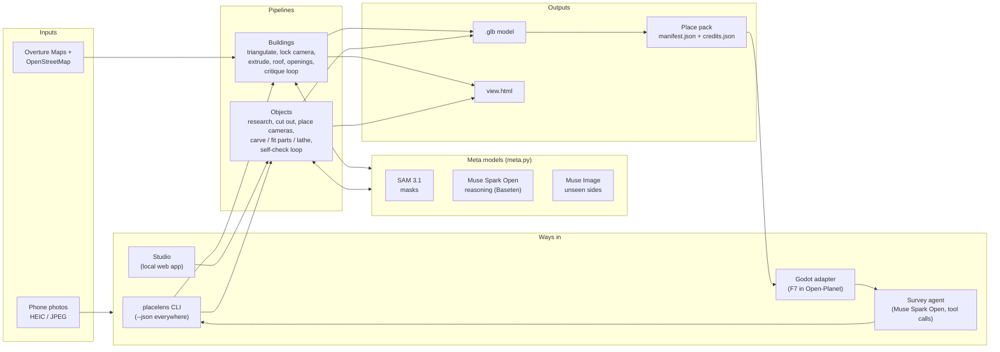
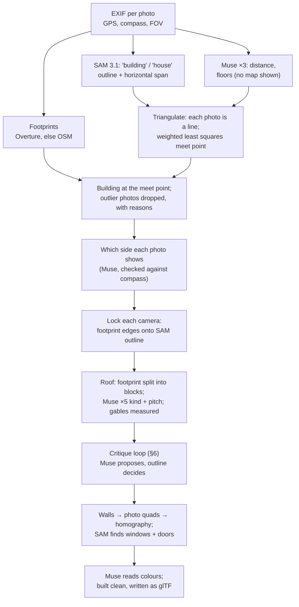
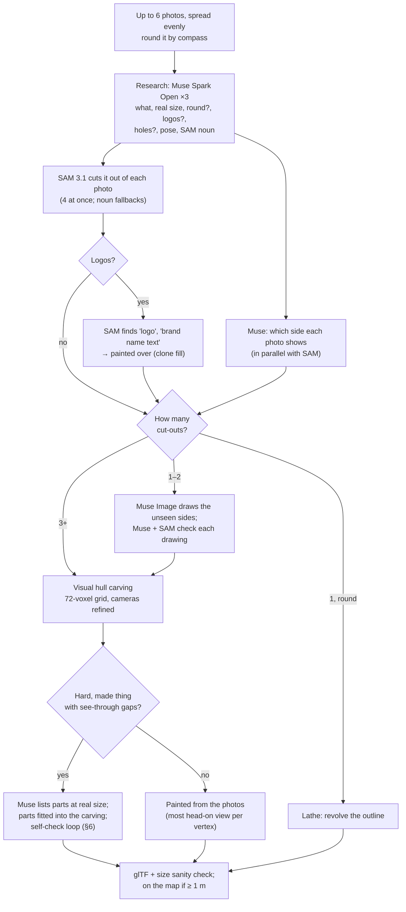

# PlaceLens architecture

How PlaceLens turns phone photos into 3D models at real size on the real map: every Meta model call, what it's for,
and the geometry around it. The [README](../README.md) is the short version; this is the long one.

- [1. The design rule: sensors first, models for the gaps](#1-the-design-rule-sensors-first-models-for-the-gaps)
- [2. System overview](#2-system-overview)
- [3. The Meta model layer](#3-the-meta-model-layer)
- [4. Buildings](#4-buildings)
- [5. Objects](#5-objects)
- [6. Verification loops: models propose, measurements decide](#6-verification-loops-models-propose-measurements-decide)
- [7. The survey agent](#7-the-survey-agent)
- [8. Outputs: glTF, place packs, the Godot adapter](#8-outputs-gltf-place-packs-the-godot-adapter)
- [9. PlaceLens Studio](#9-placelens-studio)
- [10. Cost, speed and reliability](#10-cost-speed-and-reliability)
- [11. Testing](#11-testing)
- [12. What we tried and dropped](#12-what-we-tried-and-dropped)
- [13. Module map](#13-module-map)

---

## 1. The design rule: sensors first, models for the gaps

A phone photo already holds most of what's needed to place a thing on a map:

| Fact | Free source | Typical error |
|---|---|---|
| Where you stood | EXIF GPS | 5–15 m |
| Which way you faced | EXIF `GPSImgDirection` (compass) | 10–20° (much worse indoors) |
| How wide the lens saw | EXIF 35 mm-equivalent focal length → horizontal field of view | small |
| The building's shape and position | Overture Maps / OpenStreetMap footprint | depends on the mapper |

What sensors *can't* tell is semantic: what the thing is, which pixels belong to it, how tall it is, how many floors,
what kind of roof, which side a photo shows when the compass is unreliable. **Those, and only those, go to Meta's
models.** Every model answer is then checked against geometry before it's used (§6). That rule is why a make costs
cents rather than dollars, and why one bad answer can't wreck a result.

### The trick: no model ever generates 3D

The usual way to get 3D from photos is a large image-to-3D model that guesses the whole shape. PlaceLens doesn't use
one. Every model call is a **small question about a flat photo**: a SAM 3.1 mask (a quarter of a US cent) or a short
Muse answer (a size, a side, a roof type). The 3D is made by **classical geometry on the user's own CPU**: carving a
visual hull, extruding a footprint, fitting a few parts. That geometry costs nothing and takes seconds.

| | Image-to-3D model | PlaceLens |
|---|---|---|
| What the AI does | Invents the whole 3D shape | Answers 2D questions: which pixels, what is it, how big |
| What makes the 3D | The model | NumPy on your computer: projection, carving, marching cubes |
| Real size and position | Unknown | From EXIF, the map and Muse's size, then checked |
| Checked against the photos | Not by design | Every result is projected back onto the photos and scored (§6) |

A make costs 0.25¢–8.5¢ in Meta API calls (an aloe plant: 4 photos, 49 s, 1¢), plus Muse Spark Open tokens on Baseten.

The trade-off is honest: carving can only remove what some photo sees as background, so a hollow no photo looks into
stays filled, and thin parts are hard. For game props that sit in a stylised world, that's a good trade: real size,
real colours, the right silhouette from every side, in under a minute, for about a cent.

## 2. System overview



Everything ends up in one of two pipelines (`build` for buildings, `object` for objects), reached four ways. The
studio and the agent run them as **subprocesses with `--json`**, the same commands a person would type. That keeps
one code path, makes every step reproducible from the shell, and means a crash in one make can't take down the
caller.

## 3. The Meta model layer

All model traffic goes through [`meta.py`](../src/placelens/meta.py) (one client, one cost tally) and
[`muse.py`](../src/placelens/muse.py) (caching and voting). No other module talks to an API directly, which is what
lets the tests run with no key and no network.

### Models, endpoints and why each one

| Model | Model id | Endpoint | What PlaceLens asks it | Why this model |
|---|---|---|---|---|
| **SAM 3.1** | `sam-3.1` | Meta Model API `POST /v1/responses` (streamed), `metadata.mask_encoding: "one_bit"` | Pixel masks for a short noun phrase: `building`, `house`, `teddy bear`, `window`, `garage door`, `logo`, `brand name text` | Text-prompted segmentation at full resolution. The masks are the ground truth that every other answer is checked against |
| **Muse Spark Open** | `meta-models/muse-spark-open-1026` | Baseten `POST /v1/chat/completions` (OpenAI-compatible, `reasoning_effort`, tool calls) | All the reasoning: what it is, real size, floors, distance, roof type and pitch, which side a photo shows, materials, critiques of the model drawn over the photos, parts lists, the survey agent's planning | Open weights; strong multi-image reasoning; supports tool calls and a thinking budget. Running on hackathon credits, it's cheap enough to **ask 3–5 times and vote** |
| **Muse Spark** | `muse-spark-1.3` | Meta Model API `POST /v1/responses` | The same questions, when no Baseten key is set; a second opinion on a side that Spark Open was unsure of (`--second-opinion`) | Same family on the main API, so PlaceLens works with just one key |
| **Muse Image** | `muse-image-1.0` | Meta Model API `POST /v1/images/edits` (multipart, up to 10 reference images) | Draw the back, left and right of an object from a single photo | It keeps pose and colours when drawing standard views. Each drawing is then checked by Muse and SAM before it's used (§5) |

SAM's masks come back in Meta's compact run-length format and are decoded with Meta's own
[`meta-sam-parser`](https://github.com/meta-models/meta-sam) (`image_segmentation_format().create_parser()`,
`decode_mask_to_raster`), not by hand. Big masks come back scaled down and are resized to their bounding box. Decoding
is slow in pure Python (2 of a cached house's 2.5 minutes, 1 Nov), so decoded masks are cached beside the raw reply as
`.masks.npz`.

### Every question goes through `muse.ask`

```python
answers = ask(meta, prompt, photos, reply=Path(".../roof_ab12cd34.txt"), model=OPEN, votes=5, effort="high")
```

- **Cached on disk.** Each vote's reply is saved to a file named from the prompt's hash. Asking again is free, so
  **Remake** in the studio and re-running a command cost nothing unless the question changed. Adding the user's
  notes changes the prompt, and so the cache key, so only what the notes affect is asked again.
- **Voted.** One answer's numbers wobble: Spark Open put the same house 4 m and 11 m away. So numeric questions are
  asked 3–5 times **in parallel** (8 threads; Baseten answered 8 at once in 17 s against 13 s for one) and merged:
  the median for numbers, the majority for choices, with the share that agreed folded into the confidence
  (`merge_props`, `merge_sides`, `merge_verdicts`, `merge_looks`).
- **Failure-tolerant.** A vote that times out or comes back empty (cut off while still reasoning) is left out, not
  saved, and asked again next time. The question fails only if *no* vote came back.
- **Reasoning budget.** Spark Open gets `max_tokens` 6,000, or 16,000 at `effort="high"`. High effort is used only
  where it pays: building critiques and parts lists. The agent's planning runs at `low` (one planning call once
  thought for 116 s).
- **Timeouts.** 90 s and 2 retries on Baseten. The client's default of 600 s once hid a 257 s stall.

### Cost control built into the client

- Every paid call is priced from Meta's published rates (SAM $2.50 per 1,000 images; Muse Spark $1.25 / $4.25 per 1M
  input / output tokens; Muse Image $0.01 a picture) and appended to `out/meta_usage.jsonl`. Every Spark Open call
  logs its tokens and seconds to `out/open_usage.jsonl`. `usage_since(t)` adds both logs up, so a make run as a
  subprocess still reports its own cost to the studio or the agent.
- `PLACELENS_META_OFF=1` turns any paid Meta call into a `PaidCallBlocked` exception, so a whole run can be replayed
  from saved replies with a guarantee of spending nothing. The game's panel exposes the same switch.

## 4. Buildings

`placelens build house_*.jpg` → `building.glb`, `place.geojson`, `view.html`.



**Footprints** ([`footprints.py`](../src/placelens/footprints.py), [`osm.py`](../src/placelens/osm.py)). Overture
Maps first, read straight from its public GeoParquet files with the `overturemaps` package. Overture merges
OpenStreetMap with buildings traced by Google and Microsoft: on one test street it found 157 from OSM plus 102 more
that nobody had mapped. If Overture can't be reached, it falls back to OSM's Overpass API, with retries and a disk
cache. A building that came from OSM keeps its `way/<id>`, so a game can replace its own box with the model.

**Which building: triangulation** ([`buildings.py`](../src/placelens/buildings.py)). Each photo becomes a line on the
map: from its GPS, along its compass corrected by where SAM's outline sits across the frame, out to the distance Muse
estimates. Muse is asked **without the map**, so its answer can't be anchored by the candidates. The lines are solved
together by **weighted least squares**: across each line, its error is the compass error at that distance (12°);
along it, Muse's distance error (35%). Before the fit, a median start point catches outliers so they can't bend it.
After it, the worst photo whose line misses by more than 3× its own error is dropped and the fit is re-run (up to 3
times). The building whose footprint contains the meeting point is chosen. If its support is under 1.5× the
runner-up's, it's a close call and the person is asked. Every dropped photo gets a reason in plain words ("its
compass or GPS is off: its line misses where the others meet by 23 m").

This replaced per-photo voting. Voting worked while the test house stood nearly alone on the map, but once Overture
filled in the neighbours, 6 of 7 photos voted for the house next door. Triangulation got it right with the same
photos.

**One photo: two independent checks must agree** ([`pick.py`](../src/placelens/pick.py),
[`view.py`](../src/placelens/view.py)). Rays are cast across the lens's field of view, plus a margin for compass
error. Each ray stops at the first wall it hits, so hidden buildings drop out. *Geometry:* SAM's outline gives the
building's left and right bearings, which are slid a few degrees against each candidate's footprint span to find
the best overlap (this also measures the compass error). *Muse:* sees the photo and the candidates' map facts and
names one, with a confidence. **Picked only if both agree, Muse is at least 70% sure, and the geometry fits at least
50% and leads the runner-up 3×.** Anything else exits with code `3` and a map of the candidates, so the person can
choose.

**Locking the camera** ([`front.py`](../src/placelens/front.py)). The phone's GPS and compass are too rough to
texture a wall. So PlaceLens searches positions within 15 m of the GPS (0.5 m steps). For each spot, the turn that
puts the footprint's projected left and right edges onto SAM's outline has a **closed form**, regularised towards
the compass and capped at 15°. Moving and turning further from what the phone said costs more. Once Muse has said
which side a photo shows, only the walls on that side are matched. That camera is what everything after it projects
through.

**Roof** ([`roof.py`](../src/placelens/roof.py)). The footprint is split at its reflex (inward) corners into
rectangular blocks, so an L-shaped house becomes two gabled blocks, as most are built. Muse reads the roof kind
(gable / hip / flat), ridge direction and pitch from the photos (5 votes, combined by confidence). Where a gable end
is visible, its pitch is **measured** from SAM's outline near the predicted peak, and that wins over Muse's guess.

**Walls, windows and doors** ([`front.py`](../src/placelens/front.py), [`build.py`](../src/placelens/build.py)).
Every wall facing a locked camera has its four corners projected into the photo. A **homography** (8-parameter
DLT) warps that quad into an upright wall image at metric scale. SAM 3.1 is asked for `garage door`, `door` and
`window` in each straightened wall, and those become real geometry: holes cut through the wall mesh with reveals,
glass set back in them, frames, glazing bars about every 0.9 m, sills that stand out, door handles, and ribbed
garage-door panels. When several photos see one wall, the view that faces it most squarely wins. Walls nobody
photographed can mirror the opposite wall of the same length (`--symmetric`).

**Built, not pasted** ([`look.py`](../src/placelens/look.py)). The walls aren't painted with the photo (that carries
trees, cars and the neighbour's fence onto them). Muse reads the colours of the walls, roof, window frames and doors,
and the model is built clean in those colours, in linear-space PBR materials.

## 5. Objects

`placelens object front.jpg left.jpg back.jpg right.jpg` → `prop.glb`, `object.json`, `view.html`.



**Research first, one question** ([`objects.py`](../src/placelens/objects.py)). Before anything is built, Muse Spark
Open looks at the front photo and answers one structured question, 3 times: what the thing is, how such things are
made, real width / depth / height, whether it's round, whether it shows a brand, whether it has see-through gaps,
how it's posed, and the best short noun for SAM. One research question replaces a scatter of small ones, and it
grounds the size in what Muse knows about the category, not just what the pixels suggest.

**Finding it with SAM.** SAM recognises things by some names and not others: it found a racing wheel as `game
controller`, not `steering wheel`. So the first photo tries Muse's candidate nouns in turn (at most 5, a quarter of
a cent each), and the rest of the photos start from the noun that worked. Seen from behind, an object may not look
like its name at all (a skull candle holder from the back looks like a vase). Then Muse is asked what *this* photo
shows, and SAM tries that.

**Where each photo was taken from.** The compass gives the angle round the object. Muse, shown the front photo next
to each other photo, names the side (front, front-left, … back, or above), and this question runs **while SAM is
still cutting out**, so it adds no wall-clock time. Muse wins where the compass is clearly unreliable (indoors) or
the object was turned in place instead of walked round. In the studio, the person can drag photos round a compass
circle to override both.

**Visual hull carving** ([`carve.py`](../src/placelens/carve.py)). Each cut-out is the object's silhouette from one
direction. A 72-voxel grid (sized 1.3× Muse's size estimate) is projected into every photo, and any voxel outside a
silhouette is carved away. A few details make this work on real phone photos:

- *Forgiveness near edges, none far away.* A voxel may fall outside one side view's silhouette and survive (the
  compass is a few degrees off), unless it's clearly outside (more than 2% of the photo height). An overhead photo
  can never be outvoted, as it's the only one that sees into hollows.
- *Frame-aware.* Beyond a photo's edge, a voxel only counts as outside if the object doesn't itself run off that
  edge.
- *Camera refinement* (`fit_cameras`). Compass angles, camera height and distance are each nudged in turn, keeping a
  step only if the strict carving then matches *all* the cut-outs better. The front photo's angle is held fixed to
  remove the gauge freedom.
- The kept grid is blurred by one voxel and meshed with **marching cubes** (scikit-image). Each vertex is painted
  from the photo that faces it most squarely.

**The maths of carving.** Each photo $i$ is a pinhole camera on a sphere round the object: angle round $a_i$ from
the compass (checked by Muse), angle down $e_i$, and distance $d_i$ from similar triangles, using Muse's real height
$H$ and the cut-out's height in pixels $h_i$ (focal length $f$ in pixels, from EXIF):

```math
d_i = f\,\frac{H}{h_i}, \qquad
\mathbf{c}_i = d_i\,(\cos e_i \sin a_i,\ \sin e_i,\ \cos e_i \cos a_i) + (0,\ y_{\text{mid}},\ 0)
```

Every voxel centre $\mathbf{p}$ is projected into every photo with the camera's right, up and forward unit vectors
$\mathbf{r}_i, \mathbf{u}_i, \mathbf{w}_i$ and the pixel where the object's middle shows, $(c_x, c_y)$:

```math
z = (\mathbf{p}-\mathbf{c}_i)\cdot\mathbf{w}_i, \qquad
\text{col} = c_x + f\,\frac{(\mathbf{p}-\mathbf{c}_i)\cdot\mathbf{r}_i}{z}, \qquad
\text{row} = c_y - f\,\frac{(\mathbf{p}-\mathbf{c}_i)\cdot\mathbf{u}_i}{z}
```

A voxel is kept if it lands inside the cut-out $M_i$ in all side photos but at most `misses`, inside every overhead
photo, and not clearly outside any (more than 2% of the photo's height from the outline, by a distance transform):

```math
\text{keep}(\mathbf{p}) \iff \sum_{i \in \text{side}} M_i(\pi_i(\mathbf{p})) \ \ge\ n_{\text{side}} - \text{misses}
\ \wedge\ \bigwedge_{j \in \text{overhead}} M_j(\pi_j(\mathbf{p}))
\ \wedge\ \neg\,\text{clearly\_outside}(\mathbf{p})
```

Then only the largest connected piece is kept. The whole grid (up to 72³ ≈ 370,000 voxels) is projected as one NumPy
array per photo, which is why carving takes seconds. Camera refinement (`fit_cameras`) re-runs this carving hundreds
of times while nudging each camera, so each photo's distance-to-outline map is computed once and cached.

**The score every check uses** is intersection over union between the model's silhouette $S$ and SAM's cut-out
$M$, averaged over the photos:

```math
\text{IoU}(S, M) = \frac{|S \cap M|}{|S \cup M|}, \qquad
\text{score} = \frac{1}{n}\sum_{i=1}^{n} \text{IoU}(S_i, M_i)
```

**One or two photos.** Two silhouettes crossed carve a block, so instead **Muse Image draws the missing standard
sides** (back, left, right). It doesn't always draw what was asked, so **Muse Spark looks at each drawing next to
the photo and names the side it shows**, and **SAM must find the object in it** (a drawing of the wrong side, or
one SAM can't find, is dropped). The drawings that pass carve gently: their outlines are widened by 3% and they only
paint what no real photo sees. A round thing (a pot, a tank) skips this and is **turned on a lathe** from its one
outline ([`prop.py`](../src/placelens/prop.py)).

**Parts for hard, made things** ([`parts.py`](../src/placelens/parts.py), [`fit.py`](../src/placelens/fit.py)).
Carving can't make a flat seat or open a gap that no outline shows: an office chair came out lumpy. For things
the research flags as hard and see-through, Muse Spark Open (high effort) lists the object as simple shapes at real
size: boxes, cylinders and spheres with position, size, rotation, colour and finish, in Open-Planet's own prop
format. Then [`fit.py`](../src/placelens/fit.py) slides, scales and rotates the set as a whole until the parts sit
inside the carving and fill it, scored on how much of each part is inside the carving and how much of the carving
they fill. Twin parts (left/right armrests) and sets (five chair legs) are kept consistent. Each part takes the
photos' colour where it sits. Then the self-check loop corrects it (§6).

**Brands** ([`objects.py`](../src/placelens/objects.py) `_unbrand`). If the research says the object shows a brand,
SAM is asked for `logo` and `brand name text`. Each mask is widened by 8 px and filled from the surrounding surface
before anything is carved or painted. A "logo" covering more than a quarter of the object is taken to be the object
itself and left alone. The object's name is also asked for again without the brand.

**Real size, real place.** The built model's biggest dimension is checked against the research's: off by more than
1.6× either way, and the user is told. Anything 1 m or bigger is placed on the map from the front photo's GPS,
compass, its position across the frame and Muse's distance. Anything smaller is "something you can carry" and goes
in the game's inventory instead (a phone's GPS is metres out, and a steering wheel landing in the garden is worse
than not placing it).

## 6. Verification loops: models propose, measurements decide

The pattern that runs through PlaceLens: **Muse is good at seeing *what* is wrong and rough at *how much*. SAM's
outline is exact but can't say what anything is.** So Muse proposes and the outline decides. No model edit is ever
kept on the model's say-so.

### Building critique ([`critique.py`](../src/placelens/critique.py))

1. The current model is drawn over every photo from its locked camera.
2. Muse Spark Open (high effort) sees those overlays and answers from a **fixed menu of edits**: move a wall, notch
   one in or out, raise or lower the eaves, change a roof block's pitch.
3. Each proposed edit is tried at several scales, and is **kept only if the mean error across photos drops by a set
   margin** (5% for wall moves and notches, 2% for the rest) **and more photos get better than worse**. One photo
   improving a lot can't carry a change the rest disagree with. Muse's answers are voted too: an edit is proposed only
   if several answers agree on it.
4. Error is measured two ways, with no API call:
   - **Profile error:** column by column, where the model's silhouette top starts against where SAM's starts, as a
     share of the photo height. The bottom is ignored: gates, cars and walls stand in front of it in most street
     photos.
   - **Corner error:** each model corner the camera sees should land on a strong vertical line in the photo (found
     locally, inside SAM's mask, from the image gradient). The roofline alone can't see a recess facing the camera;
     the corners can.
5. Up to 3 rounds. After a footprint edit, each camera is re-locked onto the new shape.

### Object self-check ([`sight.py`](../src/placelens/sight.py))

1. The parts model's silhouette is drawn over up to 4 photos in one picture: red where the model is and the object
   isn't, blue where the object is and the model isn't, purple where they agree.
2. Muse answers with up to 8 small edits by part number (move, resize, turn, remove), not a whole new model.
3. Each edit is tried at 100%, 50% and 150% of what Muse said, clamped (moves ≤ 25% of the object's size, scale
   0.5–2×, turns ≤ 30°), and scored by **mean IoU between the model's silhouette and SAM's cut-out across every
   photo at once**, so fixing one view can't quietly break another. Kept only if the mean rises by at least 0.005.
4. Repeated for the number of **Self-checks** set in the studio (`--moves`, default 3, at most 6).

### Other checks of the same kind

- **Sides:** Muse's "this is the back" is discarded if the compass, however rough, points the opposite way
  ([`sides.py`](../src/placelens/sides.py)).
- **Drawn sides:** a Muse Image drawing is used only if Muse names the side it shows and SAM finds the object in it.
- **Parts:** if the parts' outline matches the photo less than 50%, Muse gets one correction attempt with both
  pictures. Failing that, the carving is used instead ([`parts.py`](../src/placelens/parts.py)).
- **Building pick:** geometry and Muse must agree (§4).

## 7. The survey agent

`placelens survey my_photos/` ([`survey.py`](../src/placelens/survey.py)) turns a mixed folder into a place pack with
no further input. The game's F7 panel runs this.

- **Model:** Muse Spark Open on Baseten, using native **tool calls** via chat completions, at low reasoning effort.
- **Tools:** `list_photos` (EXIF plus suggested groups: photos within 40 m and 2 hours of each other), `describe` (up
  to 4 photos in one look), `pick`, `build`, `prop`, `pack`, `ask_person`. All except `list_photos` and `describe`
  are **PlaceLens's own CLI commands run as subprocesses with `--json`**. The agent can do nothing a person couldn't
  type, and a crash in a tool comes back as `{"error": ...}` for it to read, not as an exception.
- **Budgets:** 15 heavy calls (`pick` / `build` / `prop` / `pack`), 80 calls in all, 10 looks. Tool results are cut
  to 4,000 characters before the model sees them (the full text is in the transcript). When the budget runs out, the
  agent is made to write its summary with no tools.
- **Guardrails from real runs:** the prompt says to build a building with *all* its photos in one call (it once built
  one house as two), not to retry failures with small changes, and never to run the same heavy call twice. If the
  person says "it's one object", the agent loses `pick` and `build`, and `prop` is given every photo in the folder
  (it once sent 5 of 10).
- **Fast path:** if the photos form at most 3 groups and one cheap look at each group's first photo is at least 70%
  sure what it is, the agent's exploration is skipped (that saved 3 minutes on a teddy bear).
- **Asks only when unsure:** `ask_person` saves a question and the agent carries on. The person's notes ("the back
  is the same as the front", "about 20 m wide") become tool arguments where possible and are passed through to every
  Muse prompt otherwise.
- **Auditable:** `transcript.json` holds every message and tool result; `summary.md` is written for a person. Anything
  built but not packed is packed automatically.

## 8. Outputs: glTF, place packs, the Godot adapter

**glTF binary** ([`build.py`](../src/placelens/build.py) `write_glb`). Written directly: no Blender, no three.js
exporter, just `struct` and NumPy into a `.glb` with positions, normals, UVs, PBR materials and embedded textures.
Metres, Y up. Buildings use X east and Z south with the origin at the footprint's centre at ground level. Props face
+Z. It opens in Godot, Unity, Unreal, Blender and any browser.

**`view.html`** ([`viewer.py`](../src/placelens/viewer.py)). One self-contained file with the model embedded, which
you can spin and zoom in a browser.

**Place packs** ([`pack.py`](../src/placelens/pack.py)). Any number of builds gathered into one folder:

```
manifest.json   format "placelens-pack". Buildings: lat, lon, yaw_deg, the OSM id they replace, footprint,
                height, roof. Props: lat, lon (or null), yaw_deg, facing_bearing, size.
credits.json    map data, photos and models used, with licences
*.glb           the models
```

A building is already turned to the map (`yaw_deg` 0). A prop's `yaw_deg` turns its +Z front to face the bearing it
was photographed facing. A prop with no GPS has `lat`/`lon` null, and the game puts it in front of the player.

**Godot adapter** ([`adapters/godot/`](../adapters/godot)). `install.py` copies 4 scripts into
[Open-Planet](https://github.com/inlighten420/open-planet) (Godot 4.7, the existing game PlaceLens plugs into; not
part of this entry) and adds one autoload line to `project.godot`; `--uninstall` reverses it.

- `placelens_packs.gd` reads packs by lat/lon, loads models on a worker thread, and **hides the map's grey box for
  that OSM building**.
- `placelens_maker.gd` (F7) starts the survey agent in the background and shows its `progress.jsonl` steps live while
  you keep driving.
- `placelens_inventory.gd` (I) lets you put things anywhere, or use a steering wheel you made as your car's.

The studio's **Send to game** writes into the game's pack folder, which the game polls once a second.

## 9. PlaceLens Studio

`placelens studio` ([`studio.py`](../src/placelens/studio.py), [`studio.html`](../src/placelens/studio.html)) is a
standard-library `ThreadingHTTPServer` bound to **127.0.0.1 only**, with one HTML page and no build step or
framework. Each **Make** runs `placelens object` as its own process (the same maker the game and agent use), so a
crash or a slow make never blocks the page. Progress comes from the same `progress.jsonl` the game reads.

- **Compass circle:** every photo is placed round the object by its EXIF heading (`/headings`); dragging one passes
  `--views` to override both the compass and Muse.
- **How it was made:** a timeline parsed from the progress log. Each step shows which Meta model did it and how long
  it took, alongside the cost from the usage logs.
- **Remake:** the same photos again. Because every answer is cached (§3), this is fast and almost free.
- **Keys:** pasted once, written to the local `.env` (gitignored), never sent anywhere but Meta and Baseten.
- **Safety:** the server listens on localhost only and checks the `Host` header (against DNS rebinding). Every POST
  must carry the studio's own `Origin` (so no other website can drive it). Uploads accept only photo types, with
  sanitised names, and downloads must be `.glb` files inside the output folder (`is_relative_to`).

## 10. Cost, speed and reliability

| Technique | Where | Effect |
|---|---|---|
| Sensors and maps before models | everywhere | most facts are free |
| One research question, voted | `objects.py` | one round trip instead of many small ones |
| Disk cache keyed by prompt hash | `muse.py`, `meta.py` | remakes cost about nothing |
| Parallel votes (8) and parallel SAM (4) | `muse.py`, `objects.py`, `buildings.py` | latency is about one call, not N |
| Side questions run during SAM cut-outs | `objects.py` | saved 10–25 s a make |
| Decoded masks cached as `.npz` | `meta.py` | a cached house went from 2.5 min to seconds |
| Photo downscaled to 1,600 px long side | `pick.py` | smaller uploads, same masks |
| At most 6 photos, chosen spread round the object | `objects.py` | more carves the same shape, slower |
| Effort budgeted per question | `muse.py`, `cli.py` | high only for critiques and parts |
| 90 s timeout and retries on Baseten | `meta.py` | a stall costs 90 s, not 10 minutes |
| `PLACELENS_META_OFF=1` | `meta.py` | provably free replays |

Real makes in the studio cost between 0.25¢ and 8.5¢ in Meta API calls, plus 2–8 Muse Spark Open calls for an object and 127 for a 10-photo house. The table is in the [README](../README.md#results-and-cost).

Every failure is designed to lose one photo, not the make. A photo SAM can't cut out, whose compass disagrees, or
whose line misses is left out **with a reason the person can act on**. Exit codes are machine-readable for agents:
`2` means a photo is missing something (with the flag that fixes it: `--lat` / `--lon` / `--heading`), and `3` means
not sure which building it is.

## 11. Testing

159 tests in [`tests/`](../tests), **offline and keyless**: they run in about 20 s and in CI on every push
([`.github/workflows/test.yml`](../.github/workflows/test.yml), with `ruff` lint as well).

- **API layer:** a real SAM 3.1 reply ([`tests/data/sam_city_hall.txt`](../tests/data/sam_city_hall.txt), of a
  CC-licensed Wikimedia photo) is decoded through `meta-sam-parser` and checked. Clients are fakes that record what
  they were asked.
- **Geometry on synthetic scenes:** triangulation with a planted outlier, camera locking against a known pose,
  homographies, roof blocks on L-shaped footprints, visual hull carving of known shapes from synthetic silhouettes,
  part fitting, glTF round-trips.
- **Model-answer parsing:** every parser is tested on messy real-world replies (prose round the JSON, missing
  fields, `<think>` blocks).
- **Loops:** the critique and self-check loops are tested to keep only edits that improve the score.
- **Agent:** `Survey` takes its model, tool runner and photo describer as injected callables, so the whole loop is
  tested with scripted model replies: budgets, error handling, auto-packing, the "it's one object" mode.
- **Studio:** a real server on a random port is tested for its Host and Origin checks; uploads, downloads, delete,
  remake, Send to game and the "how it was made" timeline are tested against a temporary folder.

## 12. What we tried and dropped

| Tried | What happened | Now |
|---|---|---|
| Muse Wonder to pick the building | 53 s and $0.09 a photo | Muse Spark Open, voted |
| Each photo voting on the building | Chose the neighbour 6–1 once Overture filled in the map | Triangulation (§4) |
| Muse Image cleaning up photographed fronts, pasted on walls | Trees, cars and fences ended up on walls | Built clean from Muse's colours plus real openings |
| 128-voxel carving | Lumpier on fur, not more detail | 72 voxels plus a one-voxel blur |
| Carving only, for every object | Chairs came out lumpy | Parts fitted to the carving for hard, made things |
| SIFT plus essential-matrix camera recovery ([`solve.py`](../src/placelens/solve.py), [`scripts/match_probe.py`](../scripts/match_probe.py)) | Works with photos 30–45° apart and textured rooms; fails on fur and plain paint | Kept as an option on `prop --match`; compass + Muse + `fit_cameras` by default |
| One SAM noun per object | SAM didn't know some things by their obvious name | Noun fallbacks, and Muse renames per photo |
| The OpenAI client's default 600 s timeout | Hid a 257 s stall | 90 s plus retries |

The first-generation object maker, `placelens prop`, is still in the CLI next to the current `placelens object`.
It holds the experiments above that didn't become defaults: the Muse "judge" that trims pockets no photo sees into
([`judge.py`](../src/placelens/judge.py)), material families clustered in Lab space ([`dress.py`](../src/placelens/dress.py)),
and SIFT matching.

## 13. Module map

| Module | Lines | Role |
|---|---:|---|
| **Inputs** | | |
| [`photo.py`](../src/placelens/photo.py) | 74 | EXIF: GPS, compass, field of view (HEIC via `pillow-heif`) |
| [`footprints.py`](../src/placelens/footprints.py) | 112 | Overture Maps buildings, OSM fallback |
| [`osm.py`](../src/placelens/osm.py) | 83 | Overpass API with retries and cache |
| **Meta models** | | |
| [`meta.py`](../src/placelens/meta.py) | 297 | One client: SAM 3.1, Muse Spark, Muse Image, Spark Open (Baseten); cost logs; paid-call switch |
| [`muse.py`](../src/placelens/muse.py) | 133 | Cached, parallel, voted questions and the merges |
| **Buildings** | | |
| [`view.py`](../src/placelens/view.py) | 111 | View cone, occlusion ray-casting, candidates |
| [`pick.py`](../src/placelens/pick.py) | 237 | One photo: geometry line-up + Muse, must agree |
| [`buildings.py`](../src/placelens/buildings.py) | 262 | Many photos: weighted least-squares triangulation |
| [`sides.py`](../src/placelens/sides.py) | 70 | Which side a photo shows, checked against the compass |
| [`front.py`](../src/placelens/front.py) | 303 | Camera lock, visible walls, homography, gable pitch |
| [`roof.py`](../src/placelens/roof.py) | 236 | Footprint → blocks → gable / hip / flat roofs |
| [`critique.py`](../src/placelens/critique.py) | 508 | Muse-proposed, outline-verified shape edits |
| [`look.py`](../src/placelens/look.py) | 46 | Colours of walls, roof, frames, doors |
| [`build.py`](../src/placelens/build.py) | 500 | Meshes (walls with real openings, roofs) and the glTF writer |
| **Objects** | | |
| [`objects.py`](../src/placelens/objects.py) | 914 | The object pipeline end to end |
| [`carve.py`](../src/placelens/carve.py) | 384 | Visual hull, camera refinement, marching cubes, painting |
| [`imagine.py`](../src/placelens/imagine.py) | 29 | Muse Image prompts for unseen sides |
| [`parts.py`](../src/placelens/parts.py) | 264 | Muse's parts list → meshes; outline check |
| [`fit.py`](../src/placelens/fit.py) | 334 | Parts fitted into the carving |
| [`sight.py`](../src/placelens/sight.py) | 278 | Self-check loop scored by mean IoU |
| [`prop.py`](../src/placelens/prop.py) | 239 | Extruded cut-outs, lathe, map placement |
| [`judge.py`](../src/placelens/judge.py), [`dress.py`](../src/placelens/dress.py), [`solve.py`](../src/placelens/solve.py) | 984 | First-generation `prop` experiments (§12) |
| **Orchestration and outputs** | | |
| [`cli.py`](../src/placelens/cli.py) | 1,895 | Every command; `--json`; the building pipeline |
| [`survey.py`](../src/placelens/survey.py) | 522 | The tool-calling agent |
| [`studio.py`](../src/placelens/studio.py) + [`studio.html`](../src/placelens/studio.html) | 620 + page | Local web app |
| [`pack.py`](../src/placelens/pack.py) | 87 | Place packs |
| [`viewer.py`](../src/placelens/viewer.py), [`render.py`](../src/placelens/render.py) | 140 | `view.html`, map pictures |
| [`progress.py`](../src/placelens/progress.py) | 74 | JSON-lines progress for the game and studio |
